# Лаба 3 — Платформа для shop

Так, будем баловаться сначала с правилами на входе в api сервер кластера, потом создадим чарт для наших сервисов, который будет соответствовать правилам. Потом заведем postgres через оператора и будем долго все это пытаться сломать хихихи

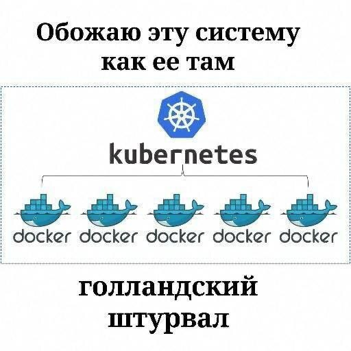 

## Содержание

- [Часть 0 — Сервисы](#часть-0--сервисы)
- [Часть 1 — Ограждения на кластер](#часть-1--ограждения-на-кластер)
- [Часть 2 — Чарт api и worker](#часть-2--чарт-api-и-worker)
- [Часть 3 — Postgres через оператора](#часть-3--postgres-через-оператора)
- [Часть 4 — Падение control plane](#часть-4--падение-control-plane)
- [Часть 5 — Мониторинг](#часть-5--мониторинг)

---

## Часть 0 — Сервисы

Так, ну навайбкодили сервис, вот че он умеет: \

**Стек:** Go, `net/http`, драйвер `pgx/v5`.

**`api` — эндпоинты:**
- `GET /health` — `ok`, либо 5xx при `HEALTH_FAIL=true`
- `POST /order` — пишет заказ в `orders`
- `GET /orders` — возвращает последние 200 заказов

**`worker`:** раз в секунду забирает пачку `processed=false` (`FOR UPDATE SKIP LOCKED`), помечает обработанными.

**Переменные окружения:**
- `DATABASE_URL` — строка подключения к Postgres
- `HEALTH_FAIL` — только для `api`, ломает readiness (нужно в части 2)

---

## Часть 1 — Ограждения на кластер

### Выбор движка политик

Выбрали движок Kyverno, по описанию он легче для входа, плюс не надо изучать новый язык, хотя он умеет только кубер, но нам этого хватит для лабы, берем!

### Установка движка

Ставим через helm, тут все понятно

```bash
helm repo add kyverno https://kyverno.github.io/kyverno/
helm repo update
helm install kyverno kyverno/kyverno -n kyverno --create-namespace --version 3.9.1
```

### Правила


| № | Правило | Что требует / запрещает | Польза |
|---|---------|-------------------------|--------|
| 1 | check-limits | есть ли ограничения ресурсов(limits/requests) | чтобы под не съел всю ноду |
| 2 | check-images | образы только из указанных источников | защита от скачивания вредоносных образов |
| 3 | check-labels | должны быть теги app, team | для распределения подов по группам/командам |
| 4 | deny-privileged | запрет привилигированного режима запуска пода | базовая безопасность от дурачков |
| 5 | deny-host-access | запрет доступа к хосту | изоляция от хоста |

``` bash
kubectl get clusterpolicy

NAME              ADMISSION   BACKGROUND   READY   AGE   MESSAGE
shop-guardrails   true        true         True    65m   Ready
```

### Проверка: пять нарушающих манифестов

Подготовили плохие манифесты, которые должны быть отклонены, они в папке `policies/bad`

Пробуем их применить и получаем ошибку от kyverno

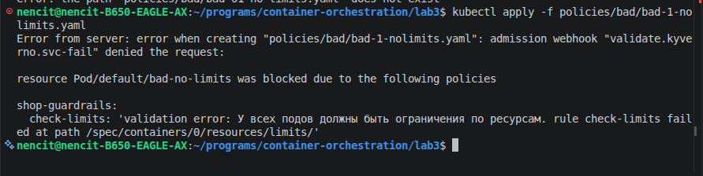\
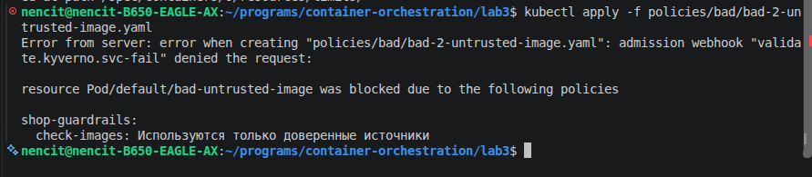\
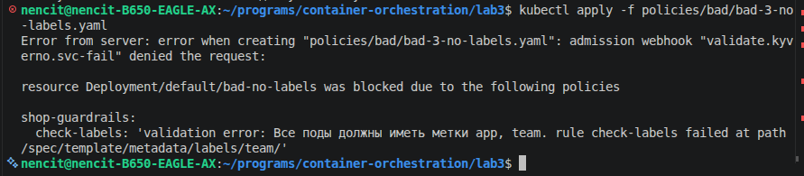\
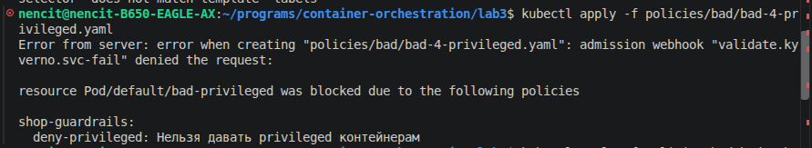\
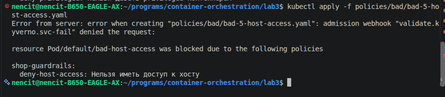

---

## Часть 2 — Чарт api и worker

### Структура чарта

Для начала создали нужные файлы для ямликов и шаблонов, и там прописали все по тз

```
charts/shop/
├── Chart.yaml
├── values.yaml
└── templates/
    ├── _helpers.tpl
    ├── deployment-api.yaml
    ├── deployment-worker.yaml
    ├── service-api.yaml
    └── ...
```
- Chart - всякая инфа про чарт, там version это версия чарта, appVersion это версия приложения
- values - параметры для api и worker: реплики, образы, ресурсы, метки, healthFail
- templates/_helpers.tpl - общие метки (shop.labels) и селекторные (shop.{api/worker}.selectorLabels).
- templates/deployment-api, deployment-worker - деплойменты с readiness/liveness пробами на /health, лимитами, метками app и team (требование политик из части 1)
- templates/service-api - Service для api, Worker Service не нужен - он не слушает порт

Все установили, kyverno нам ниче не сказал, вот и славно

### Установка

По идее все должно было быть хорошо, запустили наш чарт

```bash
helm install shop ./charts/shop -n shop --create-namespace
```

Создались наши 3 апи и 2 воркера, но они все ушли в CrashLoopBackOff, так как им нужна бд для запуска. Тут было решено перенскочить на 3 часть, поднять бд, чтобы все работало и вернуться сюда.

Так вот, после добаления бд, видим, что все работает, значит ща будем издеваться над ними

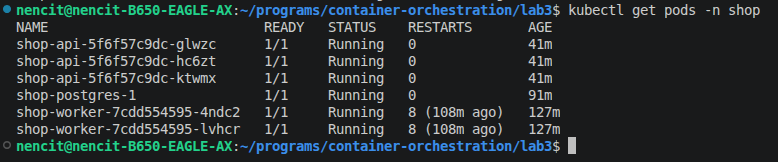

### Reconciliation: ручное удаление пода

Пробуем удалить один из подов с апи и тут же создается новый, магия какая-то ;D

```bash
kubectl delete pod ..., kubectl get pods -w
```

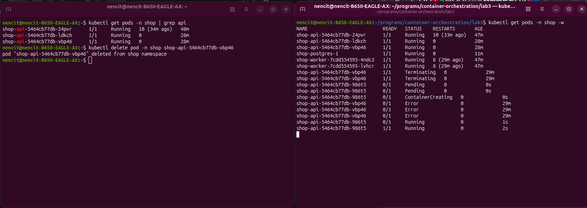

### Reconciliation: изменение replicas через helm upgrade

Тут пробуем поменять количество реплик подов для апишки с 3 на 5 и апдейтнуть, все замечательно, все 5 подов есть

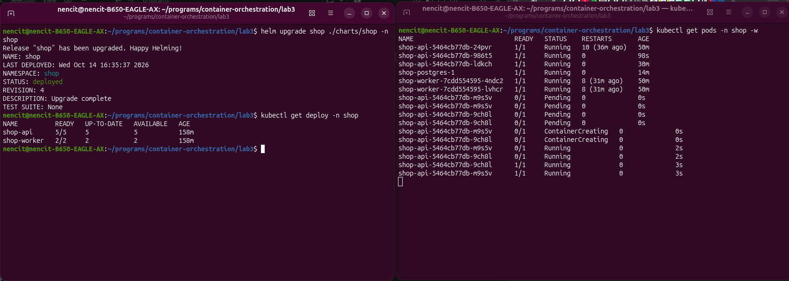

Таким же образом меняем количество реплик обратно на 3 и видим как удаляются 2 новых пода, созданных при скейле, так сделано специально, так как старые поды типо крутые, давно работают и без проблем, дедовщина какая-то

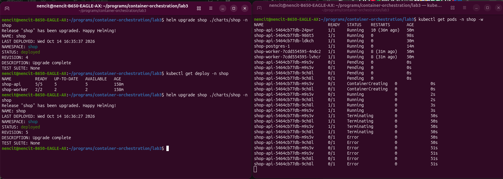

### Rolling update без потерь

Тута создадим новый образ наших приложений, т.е. просто поставим новый тег `v2` и будем выкатывать их как будто они новые \
При нашем rolling update происходит такая логика: 

Есть maxSurge - сколько доп подов можно создать сверх текущих реплик (25%) с округлением вверх, т.е. у нас создается 1 доп под, 

А так же maxUnavailable - сколько подов можно убрать из готовых (25%), т.е. мы должны иметь не менее 3 готовых подов. Это можно проследить в нашем эксперименте 

Одновременно с выкаткой, долбим /health в цикле и смотрим, чтобы ни один запрос не вернул ошибку

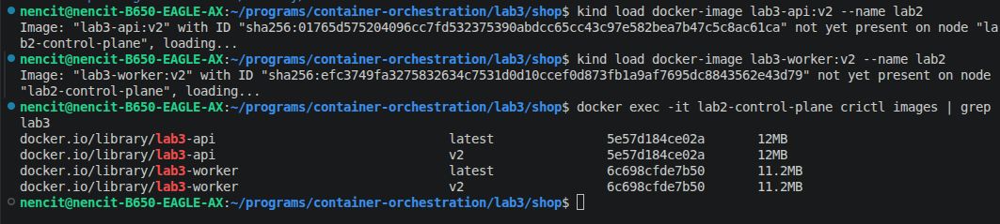 \
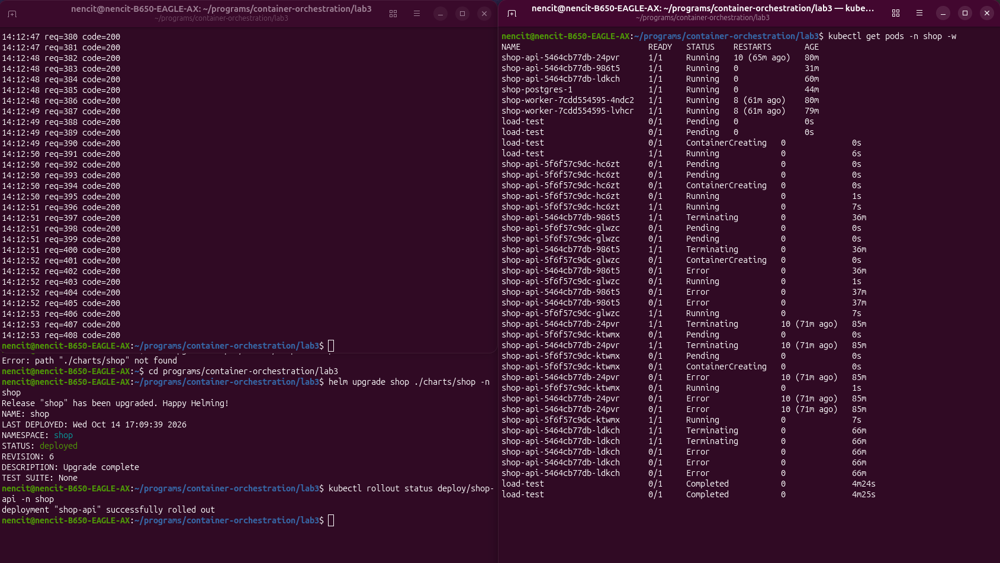 

Итого новые поды есть, почти все запросы вернули 200 (почему то один вернул код 000 спустя 2 минуты ожидания, это ошибка вероятно случилась из-за race condition между удалением пода и обновлением iptables), но глобально все круто

### Сломанный rollout и rollback

Теперь пробуем сделать почти то же самое, только делаем так, чтобы наш /health возвращал 503 код, выставляем HEALTH_FAIL=true, и пробуем, так же с запросами на этот эндпоинт, чтобы посмотреть, что новые поды не выкатываются

Видим, что все запросы вернули код 200, rollout завис, новый под рестартится (не проходит liveness) и не может пройти readyness пробу \
Делаем rollback, новый под умирает и мы ниче не выкатили, все правильно

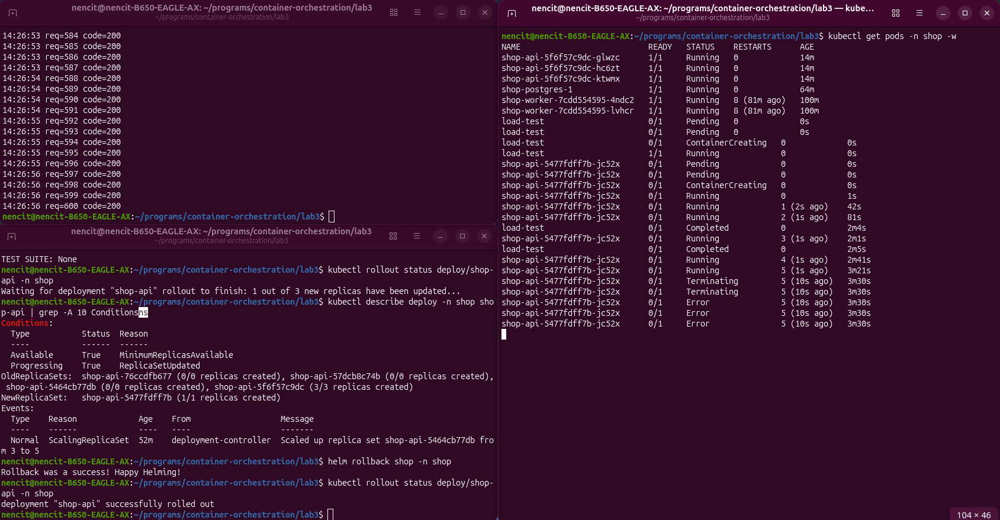 

---

## Часть 3 — Postgres через оператора

### Выбор и установка оператора

Выбрали CloudNativePG, он вроде как легче, этого уже хватило

```bash
helm install cnpg cnpg/cloudnative-pg -n cnpg-system
```

### Объект БД в чарте

Оператор установлен, далее:

В чарте добавили cluster.yaml с объектом Cluster от CloudNativePG с одним инстансом.
В values добавили секцию postgres\
Нужно было создать env переменную DATABASE_URL, которая бы передалась нашим приложениям для соединения с бд. \
В deployment-api и deployment-worker добавили env с DATABASE_URL, который достается из Secret shop-postgres-app, ключ uri (оператор генерирует его сам при создании кластера)

Оператор сам материализовал декларацию в набор объектов:

- StatefulSet shop-postgres с подом Postgres.
- Service shop-postgres-rw (primary, read-write), -ro (read-only реплики), -r (любая нода). Api/worker подключаются к -rw через DSN из Secret.
- Secret shop-postgres-app (пользователь app, готовый DSN) и shop-postgres-superuser.
- PVC shop-postgres-1 с 1 Gi.

пробуем удалить под postgres вручную и видим, что через некоторое время он запускается заново

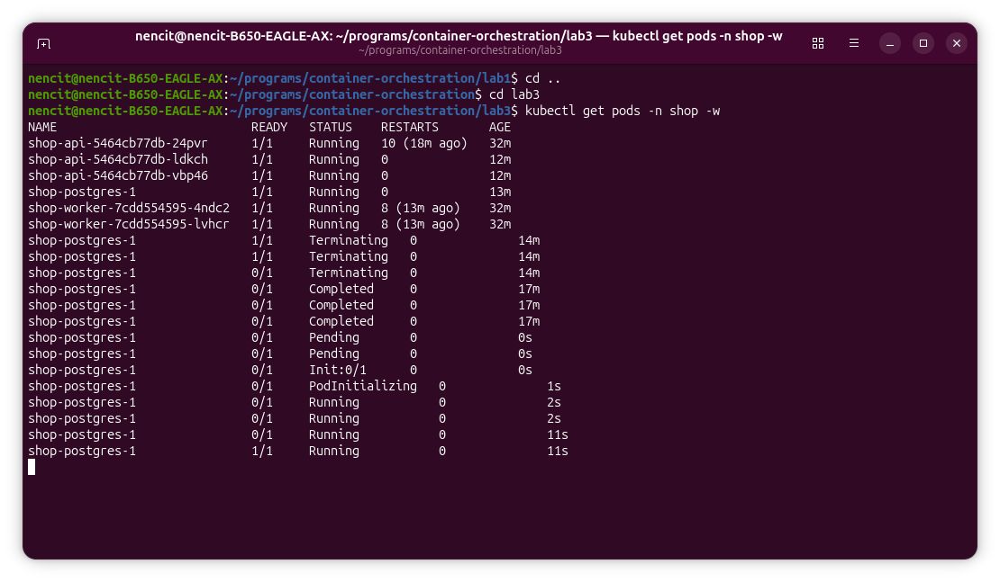 

Это работа StatefulSet'а (встроенного контроллера), но оператор следит за статусом кластера через Cluster.status — если бы потерялся сам StatefulSet, оператор бы его пересоздал

**spec и status:**

Тут особо ничего непонятно, но вот что я понял с того, что мне написал чатик:

в спеке видно то, что мы задали: кол-во инстансов, размер хранилища, ну и все, добавленное оператором\
в статусе, неожиданно, находится состояние, особенно обращено внимание на conditions, они показывают, что оператор проверяет не только жив или не жив, есть еще ConsistentSystemID и ContinuousArchiving, конкретно хз зачем это, но у Controller-manager этого нету

Микро вывод: оператор просто заточен под свой предмет(у нас это postgres), а Controller-manager нужен для управления объектами кубера, он не знает как управлять специфичными объектами

---

## Часть 4 — Падение control plane

### Как останавливал control plane

Побалуемся над контол плэйн, чтобы остановить именно etcd, заходим в ноду и внутри убираем манифест с помощью `mv`

```bash
docker exec -it lab2-control-plane bash
mv /etc/kubernetes/manifests/etcd.yaml /tmp/etcd.yaml.backup
```

### Изменения не проходят

Пробуем что нибудь сделать, ничего не выходит, все виснет, тяжело думоеца

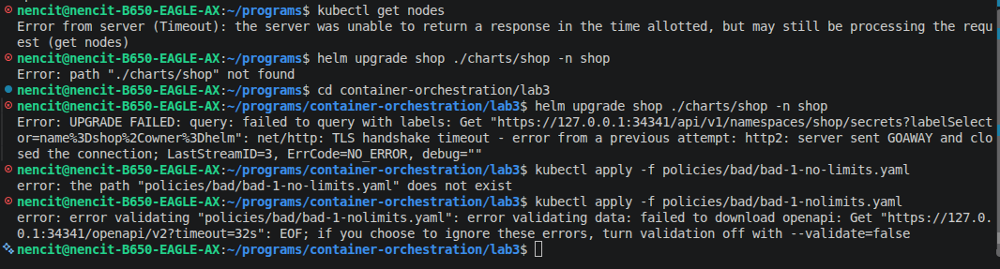 

### Приложение продолжает отвечать

Чтобы проверить работу подов, которые были запущены до поломки, внутри ноды ищем нужный контейнер с апишкой, кидаем ему запросы, оопаааа, отвечает, значит живой

```bash
root@lab2-control-plane:/# crictl exec e6eb50c0f1786 wget -qO- http://shop-api.shop/health
ok
root@lab2-control-plane:/# crictl exec e6eb50c0f1786 wget -qO- http://shop-api.shop/orders
[{"id":3,"payload":"third","processed":true,"created_at":"2026-10-14T13:15:16.157557Z","processed_at":"2026-10-14T13:15:17.06748Z"},{"id":2,"payload":"second","processed":true,"created_at":"2026-10-14T13:14:01.982182Z","processed_at":"2026-10-14T13:14:02.067268Z"},{"id":1,"payload":"first","processed":true,"created_at":"2026-10-14T13:13:56.195944Z","processed_at":"2026-10-14T13:13:57.067377Z"}]
```

### Восстановление

Вернем манифест etcd на место, все снова работает, все рады

```bash

root@lab2-control-plane:/# mv /tmp/etcd.yaml.backup /etc/kubernetes/manifests/etcd.yaml
root@lab2-control-plane:/# crictl ps | grep etcd
898a3b3f582bb       5f1f5298c888d       33 seconds ago      Running           etcd          0          58f559d0a25d2       etcd-lab2-control-plane             kube-system
```

---

## Часть 5 — Мониторинг

Используем стек из Лабы 2 
В чарт добавляем ServiceMonitor (скрейп /metrics) и PrometheusRule (3 алерта)

Добавили /metrics в апишку, теперь ServiceMonitor будет что поскрейпить

### Три алерта

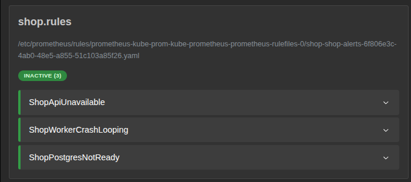 

**Алерт 1: `ShopApiUnavailable`**
- Что ловит: у Deployment api доступных реплик меньше, чем задано в spec

вызвал, задав replicaCount: 5 и healthFail: false

**Алерт 2: `ShopWorkerCrashLooping`**
- **Что ловит:** контейнер worker перезапускается больше 3 раз за 10 минут — crash loop или частая деградация.

тут было сложнее всего, ждать особенно, поудалял несколько раз воркеры и вуаля

**Алерт 3: `ShopPostgresNotReady`**
- **Что ловит:** pod Postgres не проходит readiness — база не принимает подключения

вырубил базу, быстро все сработало

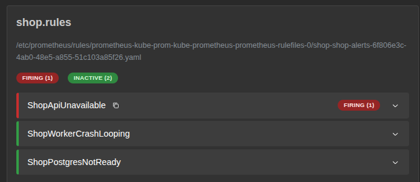 
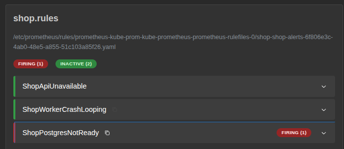 
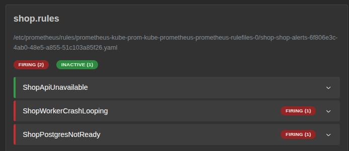 


 