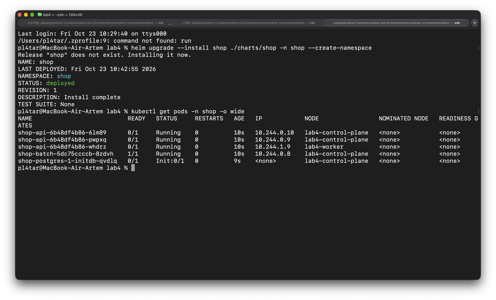

# Лаба 4 — SLA критического пути под перегрузкой

Задача: на маленьком кластере, который мы сами специально перегружаем, оформление заказа (`api → postgres`) должно продолжать работать, а страдать должна только фоновая «аналитика» `batch`. Всё настраиваем через чарт `shop` из лабы 3, числа для ресурсов берём из `krr`, а не придумываем.

Спойлер: с первого раза SLA не удержался, со второго тоже. Почему — подробно в части 8, это самое интересное в лабе.

## Содержание

- [Стенд](#стенд)
- [Часть 0 — Сервис batch](#часть-0--сервис-batch)
- [Часть 1 — Механизм разнесения](#часть-1--механизм-разнесения)
- [Часть 2 — Тесная площадка](#часть-2--тесная-площадка)
- [Часть 3 — krr vs догадка](#часть-3--krr-vs-догадка)
- [Часть 4 — Разнесение api](#часть-4--разнесение-api)
- [Часть 5 — Приоритеты, QoS, PDB](#часть-5--приоритеты-qos-pdb)
- [Часть 6 — Pending и preemption](#часть-6--pending-и-preemption)
- [Часть 7 — Eviction по памяти и OOMKilled](#часть-7--eviction-по-памяти-и-oomkilled)
- [Часть 8 — SLA под нагрузкой](#часть-8--sla-под-нагрузкой)
- [Часть 9 — Мониторинг](#часть-9--мониторинг)
- [Трудности, с которыми столкнулись](#трудности-с-которыми-столкнулись)
- [Что где лежит](#что-где-лежит)

---

## Стенд

- macOS (M2, 8 ГБ RAM), Docker Desktop, kind. Docker Desktop в итоге дали **5 ГБ** (почему не 4 — в части 2).
- Кластер `lab4`: 2 ноды, `lab4-control-plane` и `lab4-worker`, обе рабочие.
- Поверх: `kube-prometheus-stack` (релиз `kube-prom`), оператор CloudNativePG, Kyverno с гвардрейлами из лабы 3 (`guardrails.yaml`).
- Нагрузка: k6 внутри кластера ([load/k6-order.yaml](load/k6-order.yaml)) бьёт `POST /order` через Service `shop-api`.

---

## Часть 0 — Сервис batch

Код сгенерировали целиком: [shop/cmd/batch/main.go](shop/cmd/batch/main.go), [shop/Dockerfile.batch](shop/Dockerfile.batch). Это бесполезная нагрузка-заглушка для «ночной аналитики».

| env | что делает |
|---|---|
| `BATCH_CPU_WORKERS` | сколько горутин крутят CPU в бесконечном цикле |
| `BATCH_MEM_MB` | сколько памяти держать в итоге |
| `BATCH_MEM_STEP_MB` / `BATCH_MEM_STEP_SECONDS` | память растёт ступеньками, чтобы рост было видно на графиках |

Две важные детали:
- в каждую выделенную страницу памяти сервис что-то пишет, иначе память останется виртуальной и не попадёт в RSS. А kubelet и OOM-killer считают именно резидентную память, без этого часть 7 бы не получилась;
- сервис ловит SIGTERM и выходит с кодом 0. Это потом всплыло в частях 6 и 7: вытесненные поды заканчивались `Completed`, а не `Error`.

В чарте все параметры нагрузки идут из `values.batch.load` через env, поэтому в частях 6–7 мы крутили нагрузку только через `values.yaml` и `helm upgrade`.

---

## Часть 1 — Механизм разнесения

В `values.yaml` добавили параметр выбора механизма:

```yaml
api:
  spread:
    mode: topologySpread          # topologySpread | antiAffinity | none
    topologyKey: kubernetes.io/hostname
    maxSkew: 1                    # для topologySpread
    whenUnsatisfiable: DoNotSchedule
    antiAffinityType: preferred   # для antiAffinity: required | preferred
```

**Чем отличаются:**

- **`podAntiAffinity`** — попарное правило «не ставь меня туда, где уже есть под с меткой X».
  - `required…` — жёсткий фильтр: в домене не больше одной реплики, лишние уходят в `Pending`.
  - `preferred…` — только баллы в скоринге. Они складываются с баллами других плагинов (например, балансировки по ресурсам) и могут им проиграть, поэтому даже вес 100 ничего не гарантирует.
- **`topologySpreadConstraints`** — правило о распределении в целом. Планировщик проверяет для каждой ноды-кандидата `skew = (подов в домене кандидата + 1) − min(подов по доменам) ≤ maxSkew`. С `DoNotSchedule` это фильтр, со `ScheduleAnyway` — мягкий скоринг.

**Что это даёт на нашем кластере (3 реплики, 2 ноды):**

| механизм | результат |
|---|---|
| required anti-affinity | 1 + 1, третья реплика висит в `Pending` |
| preferred anti-affinity | скорее всего 2 + 1, но без гарантии |
| TSC, `maxSkew: 1`, `DoNotSchedule` | 2 + 1 гарантированно, все реплики работают |

На одной ноде TSC просто поставит всё туда (при одном домене перекос всегда 0), а required anti-affinity оставит одну реплику.

**Выбрали TSC.** Лаба требует доказуемого разнесения даже на 1–2 нодах, а это получается только с жёсткой гарантией, при которой лишние реплики не висят в `Pending`.

Нашли неочевидную ловушку: заполненная нода продолжает держать минимум в формуле. Пример — A = 3 реплики, B = 2, B забита по ресурсам. Шестая реплика: на A `(3 + 1) − 2 = 2 > 1`, A отсекает `PodTopologySpread`, B отсекает `NodeResourcesFit`, итог — `Pending`, хотя на A место есть.

---

## Часть 2 — Тесная площадка

### Конфиг кластера

[kind-config.yaml](kind-config.yaml), в нём три осознанных решения:

1. **С control-plane снят taint `NoSchedule`.** Иначе из двух нод рабочей была бы одна, и разносить `api` (часть 4) было бы некуда. Цена: системные компоненты и наши поды живут на одной ноде; для лабы нормально, в проде так не делают.
2. **`evictionHard: memory.available: "50%"`.** Ноды kind — это контейнеры в одной VM Docker, и каждая считает своей всю память VM. Kubelet каждой ноды сравнивает порог только с working set своего контейнера и соседа не видит. При пороге 50% каждой ноде достаётся максимум половина VM, а в сумме они не превысят VM целиком. При 25% каждая нода считала бы нормой 75% VM, в сумме 150%, и OOM-killer ядра VM отработал бы раньше любого kubelet. Побочный эффект: `allocatable = capacity − reserved − evictionHard` стал вдвое меньше capacity, поэтому площадка действительно тесная.
3. **Дисковые пороги — `0%`**, как в kind по умолчанию, иначе на ноутбуке поды начнут вылетать из-за диска.

Стек мониторинга ставили с [configs/prom-values.yaml](configs/prom-values.yaml), это values из лабы 2 плюс `requests` для Prometheus и Grafana. Без requests они были бы BestEffort и под давлением памяти вылетели бы раньше `batch`.


### batch в чарте

Добавили шаблон `templates/deployment-batch.yaml` и секцию `batch` в values: requests 100m / 128Mi, limits 500m / 256Mi, метка `team: analytics`. У `batch` нет проб, и это осознанно: порта нет, понятия «готов принимать трафик» у него нет, а то, что процесс жив, kubelet и так видит.

Первый `helm upgrade --install`: Helm пишет `deployed`, но подов `worker` нет.



Оказалось, тег образа набран кириллицей: `tag: м1`. Kyverno отклонил под, потому что не смог разобрать ссылку на образ:


Здесь хорошо видно, почему Helm говорит `deployed`: Helm проверяет только то, что API принял **его** объекты (Deployment). Поды создаёт уже ReplicaSet-контроллер асинхронно, и admission-политика срабатывает на каждый Pod. Ошибка видна только в событиях ReplicaSet, поэтому проверять надо `rollout status`, а не статус релиза.

После исправления всё поднялось. `api` несколько раз перезапустились, пока Postgres проходил `initdb`, это нормально:


Как планировщик видит ноды:


### Трудности части 2

- **Docker Desktop был на 3.8 GiB.** Сразу после установки Kyverno (все его 5 подов сели на control-plane, рядом с etcd и apiserver) нода перевалила порог eviction. Kubelet начал выселять. Первым ушёл BestEffort `local-path-provisioner`, и ReplicaSet пересоздавал его по кругу — набралось **57 `Evicted`**. Получилась часть 7 раньше времени. Лечение: Docker поставили на 5 ГБ, у Kyverno выключили `reportsController` и `cleanupController` (для enforcement гвардрейлов хватает admission-controller). Запас до порога на control-plane вырос со 140 до ~470 MiB.
- **zsh и `custom-columns`.** `.status.conditions[-1]` без кавычек zsh воспринимает как glob и падает с `no matches found` (видно на первом скриншоте). Лечится кавычками вокруг всего аргумента.

---

## Часть 3 — krr vs догадка

### Нагрузка

k6 внутри кластера, открытая модель `constant-arrival-rate`, 30 RPS, 30 минут.
- Внутри кластера, а не через port-forward с мака: port-forward идёт через apiserver и kubelet, сам становится узким местом и искажает задержки.
- Открытая модель держит заданный RPS, даже если `api` тормозит. Закрытая модель (N VU в цикле) сама сбросила бы темп и спрятала деградацию.


### Рекомендации krr

```bash
krr simple -n shop -p http://localhost:9090 --history_duration 1 --points_required 10
```

По умолчанию `krr` смотрит 14 дней истории и требует 100 точек, а у нас было ~30 минут данных, поэтому окно сузили.


Отчёт файлом: [krr-report.csv](krr-report.csv).


Стратегия `simple`: CPU request = 95-й перцентиль, CPU limit не ставится, memory request = limit = максимум + 15%.

### Сравнение: догадка → krr → реальность

Реальные числа сняли напрямую из Prometheus за то же окно.

| сервис | догадка (лаба 3) | krr | реально | вывод |
|---|---|---|---|---|
| api | req 100m / 64Mi, lim 500m / 128Mi | CPU 36m, memory 100Mi | P95 CPU 28–36m, max working set 13–17 MiB | память — **минимум krr** (`--mem-min 100`), а не измерение |
| worker | req 100m / 64Mi, lim 500m / 128Mi | CPU 10m, memory 100Mi | 7–9m, 11 MiB | оба числа — минимумы krr (`--cpu-min`, `--mem-min`) |
| postgres | **ничего** (BestEffort) | **нет в отчёте** | P95 CPU 237m, max 164 MiB | посчитали по формуле krr сами: **240m / 189Mi** |
| batch | — | CPU 501m | 500m, троттлинг в **99%** периодов | число не значит ничего: это потолок limit, а не спрос |

**Откуда расхождение:**
- CPU мы завысили примерно втрое, а память для Go-сервисов наоборот — 64Mi было даже много.
- Самый тяжёлый компонент пути, Postgres, остался вообще без ресурсов, то есть BestEffort, первый кандидат на выселение. Гвардрейлы его пропустили, потому что поды `cnpg.io/cluster` у нас в исключениях.
- `krr` не увидел Postgres: под принадлежит не Deployment или StatefulSet, а кастомному ресурсу CNPG `Cluster`. В README лабы 3 мы ошибочно писали, что CNPG создаёт StatefulSet.
- Цифра `batch` — артефакт limit. Метрика показывает, сколько процессу **дали**, а не сколько он хотел. С limit 2 ядра `krr` показал бы ~1000m: одна горутина в бесконечном цикле занимает ровно одно ядро.

Перенесли числа в `values.yaml`. Ресурсы Postgres задаются в CR `Cluster` (`spec.resources` в `templates/cluster.yaml`), оператор при изменении сам пересоздаёт под.


На скриншоте снимок до конца перезапуска Postgres, поэтому у него ещё старый QoS.

### Трудности части 3

- Опечатка в values: `r  resources:` вместо `resources:`. YAML принял это за другой ключ, `worker.resources` стал пустым, шаблон отрендерил под **без лимитов**, и Kyverno его отклонил. Это второй раз за лабу, когда гвардрейл поймал ошибку, которую Helm пропустил: без него worker тихо стал бы BestEffort.
- Минимумы `krr` и затроттленный `batch` легко принять за измерения, если не сверить с сырыми метриками.
- И главная ловушка, которую мы тогда только обсудили как теорию: рекомендация верна только для окна, на котором посчитана. В части 8 limit 189Mi у Postgres закончился `OOMKilled`, когда таблица выросла.

---

## Часть 4 — Разнесение api

Шаблон `deployment-api.yaml` читает `api.spread` и рендерит либо TSC, либо anti-affinity:

```yaml
      {{- with .Values.api.spread }}
      {{- if eq .mode "topologySpread" }}
      topologySpreadConstraints:
        - maxSkew: {{ .maxSkew }}
          topologyKey: {{ .topologyKey }}
          whenUnsatisfiable: {{ .whenUnsatisfiable }}
          nodeTaintsPolicy: Honor
          labelSelector:
            matchLabels:
              {{- include "shop.api.selectorLabels" $ | nindent 14 }}
          matchLabelKeys:
            - pod-template-hash
      {{- else if eq .mode "antiAffinity" }}
      ...
```

Два поля сверх того, что было в части 1:

- **`matchLabelKeys: [pod-template-hash]`.** При rolling update старый и новый ReplicaSet живут одновременно, и `app=api` видит оба. Без этого поля перекос считался бы по смеси со старыми подами, которые вот-вот удалят, и новая ревизия могла бы лечь криво. Apiserver при создании пода сам дописывает значение хеша в селектор, это видно прямо в спецификации пода (`pod-template-hash In [df885b74d]`).
- **`nodeTaintsPolicy: Honor`.** По умолчанию `Ignore`, и тогда нода с taint, на которую под всё равно не встанет, считается доменом. Пример: умер `lab4-worker`, на нём taint `unreachable`, его реплики выселены.

| | домены | min | кандидат CP (2 пода) | итог |
|---|---|---|---|---|
| `Ignore` | CP = 2, worker = 0 | 0 | `2 + 1 − 0 = 3 > 1`, отсекает PodTopologySpread | замена висит в `Pending` |
| `Honor` | только CP = 2 | 2 | `2 + 1 − 2 = 1 ≤ 1` | встаёт на CP |

Мёртвая нода, на которую никто не может встать, при `Ignore` блокировала бы живую ровно тогда, когда замена нужнее всего.

### Доказательство

Constraint в спецификации пода:


3 реплики — **2 + 1**:


`replicaCount: 4` — строго **2 + 2**. Новая реплика `2f9kw` встала на worker: на control-plane перекос был бы `(2 + 1) − 1 = 2 > 1`. Хеш у неё тот же, то есть это не rolling update, ReplicaSet просто добавил под.


### Как это повышает отказоустойчивость

Падение одной ноды больше не убивает весь `api`: на второй гарантированно остаётся хотя бы одна реплика, и Service шлёт трафик на неё, пока выпавшие переезжают. Честная цена: если упадёт нода с двумя репликами, на время переезда останется треть мощности. Разнесение спасает от полного простоя, а не от деградации.

И важно помнить: TSC проверяется только при планировании. Если нода вернётся после падения, планировщик сам реплики обратно не разнесёт, для этого нужен Descheduler. При scale-down TSC тоже не участвует, какой под удалить, решает ReplicaSet по своим правилам.

### Трудности части 4

- Ревизия 9 ничего не изменила: `replicaCount: 4` не сохранился в файле. Проверять, что ушло в релиз, лучше через `helm get values`.

---

## Часть 5 — Приоритеты, QoS, PDB

Три разных механизма защиты, каждый срабатывает в своей ситуации:

| механизм | когда работает | кто решает | что даёт |
|---|---|---|---|
| **PriorityClass** | под не влезает; порядок жертв при eviction | планировщик (preemption), kubelet (порядок) | `api`/`postgres` вытесняют `batch`; при давлении `batch` уходит первым |
| **QoS** | давление по памяти на ноде | kubelet (eviction), ядро (`oom_score_adj`) | Guaranteed не может превысить свой request, поэтому выселяется последним |
| **PodDisruptionBudget** | **добровольные** нарушения: `drain`, Eviction API | Eviction API | `drain` не уронит больше одной реплики `api` за раз |

Шаблоны: [templates/priorityclass.yaml](charts/shop/templates/priorityclass.yaml), [templates/pdb-api.yaml](charts/shop/templates/pdb-api.yaml), `priorityClassName` в шаблонах подов и в CR `Cluster`.

```yaml
priorityClasses:
  - name: shop-critical
    value: 100000
    preemptionPolicy: PreemptLowerPriority
  - name: shop-batch
    value: -10              # ниже нуля: у подов без класса (worker, мониторинг, kyverno) priority 0
    preemptionPolicy: Never # batch сам никого не вытесняет
```

- **`api`, `postgres`** — Guaranteed (request = limit по CPU и памяти), `shop-critical`. Память — по `krr`. CPU сначала взяли по минутному пику с запасом (`api` 100m, `postgres` 500m). В части 8 выяснилось, что этого мало, и подняли до 250m и 1 ядра.
- **`batch`** — Burstable (requests заметно ниже limits), `shop-batch`.
- **`worker`** — Burstable, priority 0, посередине.
- **PDB для `api`** — `maxUnavailable: 1` (а не `minAvailable: 2`, чтобы бюджет масштабировался вместе с репликами) и `unhealthyPodEvictionPolicy: AlwaysAllow` (застрявший в CrashLoop под не блокирует drain).
- **PDB для `postgres` создаёт сам CNPG** (`shop-postgres-primary`, `minAvailable: 1`), мы управляем им через `postgres.enablePDB`. Второй PDB на тот же под заводить нельзя: Eviction API начнёт отказывать из-за нескольких бюджетов на один под.


### Что даёт каждая настройка под давлением

**Порядок выселения kubelet** при давлении по памяти:
1. превышает ли usage свой request (превысившие идут первыми);
2. priority;
3. насколько usage больше request.

У Guaranteed usage физически не может превысить request (limit = request), поэтому такие поды всегда в последней группе. Burstable может вылезти за request, и тогда попадает в первую группу. Если до OOM на уровне cgroup дойдёт раньше kubelet, ядро тоже убьёт Burstable первым: у Guaranteed `oom_score_adj` = −997, у BestEffort = 1000, у Burstable считается от доли request в памяти ноды (от 2 до 999).

**Почему у `batch` −10 и `Never`.** При +10 и `PreemptLowerPriority` `batch` оказался бы выше Prometheus и Kyverno (priority 0) и мог бы их вытеснить ради своего места. А при давлении по памяти, если оба превысили requests, первым выселили бы Prometheus.

**PDB не защищает от eviction по давлению памяти.** Kubelet выселяет напрямую, мимо Eviction API, и бюджет при этом не проверяется. От давления защищают только priority и QoS.

**PDB Postgres с `ALLOWED DISRUPTIONS: 0`.** `kubectl drain lab4-control-plane` на нём зависнет: drain бесконечно повторяет eviction с `Cannot evict pod as it would violate the pod's disruption budget`. `--force` и `--ignore-daemonsets` бюджет не обходят. Обходит только `--disable-eviction`, тогда drain удаляет поды обычным DELETE. Для БД с одним инстансом это разумно: реплики нет, и простой надо осознанно принять руками.

### Трудности части 5

- `batch` дважды оставался с priority 0. Сначала `priorityClassName` не добавили в values, и под даже не пересоздался. Потом он потерялся при правках values в части 7. Заметили только по колонке `PRIO` и вернули перед финальным прогоном части 8. Вывод: проверять надо фактический под (`.spec.priority`), а не то, что написано в шаблоне.

---

## Часть 6 — Pending и preemption

Нехватку сделали «бумажной»: у `batch` крупный request (256Mi), но реально он держит почти ничего (`memMB: 8`, ~15 MB на под). Так часть 6 (планировщик) не смешивается с частью 7 (kubelet и реальная память).

| нода | allocatable | занято requests | свободно по requests |
|---|---|---|---|
| control-plane | 2459Mi | 971Mi | ~1490Mi |
| worker | 2459Mi | 1346Mi | ~1110Mi |

По расчёту при 256Mi влезает 6 + 4 = 10 подов. Подняли `batch.replicaCount` до 12, и 2 остались в `Pending`, ровно как посчитали:


Почему не влез — `NodeResourcesFit` по requests, а preemption даже не пробовался из-за `preemptionPolicy: Never`:


**Планировщик считает по requests, а не по факту.** Requests на обеих нодах **96%**, а все `batch` реально держат 64 и 46 MiB, и до порога eviction ещё 460 / 588 MiB:


Планировщик резервирует по requests, kubelet смотрит на факт. Если бы планировщик решал по факту, любой под, который сейчас простаивает, а через минуту вырастет, ломал бы все гарантии размещения.

### Preemption

Подняли `api.replicaCount` до 4. TSC пускает четвёртую реплику только на `lab4-worker`, а там по requests нет места. Планировщик выставил поду `NOMINATED NODE = lab4-worker`, вытеснил один `batch`, и через ~8 секунд `api` стал `Running`. Замена `batch` тут же снова ушла в `Pending`.


Детали, которые мы разобрали:
- **Почему жертва на worker, хотя на control-plane тоже стоят `batch`.** Preemption мысленно убирает с ноды все поды ниже по приоритету и прогоняет **все** фильтры заново. На control-plane уже 2 реплики `api`, и сколько `batch` ни убирай, перекос остаётся `(2 + 1) − 1 = 2 > 1`. CP не стал кандидатом вовсе, а критерии «меньше жертв / ниже приоритет» работают, только когда кандидатов несколько.
- **Вытеснен ровно один `batch`** — планировщик берёт минимальный набор жертв.
- **Пока жертва завершается**, место держится за `api`: другие поды с приоритетом не выше `api` при примерке на эту ноду считают requests номинированного пода уже занятыми.
- **Вытесненный `batch` закончил `Completed`**: preemption — это обычное graceful-удаление, а `batch` обрабатывает SIGTERM и выходит с кодом 0.

---

## Часть 7 — Eviction по памяти и OOMKilled

### Подготовка

Свободной памяти в VM Docker было ~980 MiB, а запасы до порога у нод — 453 + 571 MiB, то есть инвариант 50% работает впритык. Если давить на обе ноды сразу, VM кончится раньше, чем kubelet что-то заметит. Поэтому давление адресовали одной ноде: `batch` закрепили на `lab4-control-plane` через `batch.nodeSelector` в values. Это ещё и самый честный тест: там же стоят `postgres` и 2 из 3 `api`.

Values для давления: 12 реплик, request 64Mi, limit 512Mi, `memMB: 100`, рост ~1 MB/с на под (медленно, чтобы kubelet с его циклом ~10 с не проскочил порог).

### Eviction

Нода ушла в `MemoryPressure`, kubelet начал выселять `batch`. В событии прямо написан критерий отбора — usage больше request:


> `Threshold quantity: 2518168Ki, available: 2431480Ki. Container batch was using 71188Ki, request is 64Mi, has larger consumption of memory.`

(Ошибка `helm upgrade` сверху временная: в тот момент секция `batch` в values была наполовину отредактирована, следующая ревизия выкатилась нормально.)


Критический путь на той же ноде не тронут, рестартов у `postgres` и `api` не прибавилось (4 у `brvj5` — с перезапуска Postgres в части 5):


**Почему первым ушёл `batch`:** usage > request (первая группа), priority −10 (ниже всех), а у Guaranteed `postgres`/`api` usage не может превысить request.

**Карусели «выселили → поставили обратно → выселили» не было**, пока держалось давление. На ноде висел taint `node.kubernetes.io/memory-pressure:NoSchedule`, и замены стояли в `Pending` с `untolerated taint`. После снятия давления (kubelet держит его ещё ~5 минут, `evictionPressureTransitionPeriod`) замены встали и цикл повторился.

### OOMKilled по собственному лимиту

Для сравнения один `batch` на worker: limit 256Mi, хочет 400 MB, растёт по 50 MB/с. Нода спокойна (запас ~750 MiB), kubelet не участвует. Контейнер упирается в `memory.max` своей cgroup, и его убивает OOM-killer ядра. Имя пода не меняется, растёт `RESTARTS`:


Последний скриншот — готовое сравнение двух диагнозов с одинаковым симптомом «под умер, памяти не хватило»:

| | Evicted | OOMKilled |
|---|---|---|
| кто убивает | kubelet | ядро, OOM-killer cgroup |
| из-за чего | нода ниже порога `memory.available` | контейнер упёрся в свой `limits.memory` |
| что с подом | под `Failed` с `reason: Evicted`, объект остаётся, ReplicaSet создаёт **новый** | тот же под, контейнер перезапускается, растёт `RESTARTS` |
| где смотреть | `status.reason` / `status.message` пода, события `Evicted` | `lastState.terminated.reason: OOMKilled` |
| как лечить | приоритеты и QoS, разгрузка ноды | поднять limit или чинить утечку |

**Exit code 137 есть в обоих случаях.** У нас жёсткий порог (`evictionHard`), а при нём kubelet не даёт grace period и сразу шлёт SIGKILL. Поэтому exit-код диагноз не ставит, различать надо по `reason`.

Ещё два живых примера `OOMKilled` по своему лимиту случились сами собой: Grafana (limit 256Mi, а потом 512Mi — Explore поднимает её до ~500 MiB) и Postgres в части 8. Guaranteed-под защищён от eviction, но не от собственного limit.

---

## Часть 8 — SLA под нагрузкой

### Формулировка

> **95% заказов (`POST /order`) обрабатываются быстрее 100 ms в любом 5-минутном окне, ошибок меньше 1% в любой минуте, в том числе пока `batch` выселяют по давлению памяти.**

Порог 100 ms стоит на границе бакета гистограммы (`DefBuckets`: …0.05, **0.1**, 0.25…). `histogram_quantile` интерполирует внутри бакета, поэтому SLA на границе проверяется честно. Почему окно 5 минут, а не 1 — ниже.

### Прогон 1: SLA сломался

Тот же сценарий частей 6–7 под нагрузкой k6:

| время | что происходило | p95 `/order` | ошибки | CPU VM | троттлинг Postgres |
|---|---|---|---|---|---|
| 12:18–12:26 | 9–10 `batch` × 500m (часть 6) | 0.2–7 s | 0–17% | 65–84% | 3–66% |
| 12:28–12:33 | 12 `batch`, давление памяти (часть 7) | 4–9 s | до **57%** | до **93%** | до **96%** |
| после | `batch` спокоен | 31 ms | 0% | ~35% | 7% |


Ошибки 500 — это `insert failed`: k6 рвёт запрос по таймауту 5 s, контекст в `api` отменяется, INSERT падает. По сути все ошибки — переросшая задержка.

**Причина — CPU, а не память.** От памяти мы защитились правильно: никто из критического пути не выселен. Но у CPU свои механизмы, и на них было две проблемы:

1. **У CPU нет eviction и нет «первой группы».** Под нехваткой ядро делит время между cgroup пропорционально `cpu.weight`, а он берётся из **requests**. QoS-класс на распределение CPU не влияет вообще. Busy-loop `batch` съедал 4–5 ядер из 8 в VM, которую делят обе ноды и сам macOS.
2. **CPU limit у Guaranteed-подов сам стал источником задержек.** Это CFS-квота: при limit 500m Postgres может потратить 50 ms CPU за период 100 ms **суммарно по всем ядрам**. Каждое соединение в Postgres — отдельный процесс, и 8 бэкендов, параллельно делающих INSERT, выбирают квоту за пару миллисекунд, после чего вся cgroup стоит до конца периода. Отсюда троттлинг в 96% периодов при среднем потреблении всего ~230m. Минутный пик, по которому мы выбирали limit в части 5, всплесков внутри 100-миллисекундных периодов не видит.

Итог: Guaranteed гарантирует **память**. По CPU он даёт только вес по request и жёсткий потолок по limit, и низкий потолок вредит.

Исправили: `api` 250m/250m, `postgres` 1/1 (по-прежнему Guaranteed), а `batch` request 50m (малый вес в CFS) и limit 200m (12 подов — максимум 2.4 ядра вместо 6).

### Прогон 2: упал Postgres

На базовой линии второго прогона p95 снова полез до 1.5–2.2 s. Причина нашлась в статусе контейнера:

```
restarts=1  last: reason=OOMKilled  exitCode=137  finishedAt=10:01:26Z
```

Postgres умер по своему limit 189Mi, ровно как мы предполагали в вопросе части 3. Limit посчитан по 30 минутам данных, когда таблица `orders` была маленькой. К этому моменту в ней было 106 тыс. строк, `shared_buffers` (128MB) заполнялись, worker на каждом проходе читал индекс почти целиком (`Rows Removed by Filter: 97243`). В тот же контейнер входит instance manager CNPG. По минутным точкам Prometheus working set выглядел как ~135 MiB, но всплески между скрейпами доходили до лимита. Подняли до **384Mi** (`shared_buffers` + ~10 бэкендов + instance manager + запас).

### Прогон 3: SLA держится

15 минут k6: 3 минуты базы → давление (12 `batch` по 100 MB на control-plane) → 8 минут → отбой → восстановление.

| минута | фаза | p95 (1m) | ошибки | Running `batch` | троттлинг Postgres |
|---|---|---|---|---|---|
| 25–28 | база | 5 ms | 0% | 1 | ~0 |
| 28–36 | давление | ~5 ms, пики до **0.97 s** и 0.21 s в моменты выселения | 0, всплеск **0.4%** | 14 → **7** → 12 | 0–8% |
| 37–39 | восстановление | 5 ms | 0% | 1 | ~0 |


Сторона клиента (k6):


**Проверка SLA с шагом 15 s (как считает Grafana):**

| метрика | худшее значение | SLA |
|---|---|---|
| доля быстрее 100 ms, окно 5 мин | **96.2%** | ≥ 95% ✅ |
| p95, окно 5 мин | 56 ms | ✅ |
| ошибки, окно 1 мин | **0.4%** | < 1% ✅ |
| p95, окно 1 мин | 0.97 s | ❌, поэтому окно и не минутное |

- Критический путь не тронут: рестартов у `postgres` и `api` не прибавилось, их троттлинг около нуля (в прогоне 1 у Postgres было 96%).
- Деградирует `batch`: kubelet выселил половину подов, оставшиеся упираются в свой limit 200m (троттлинг 92–100%).
- k6: p95 = 10 ms, 0.01% неудачных (5 из 26 954 — таймауты 5 s в моменты выселений), `dropped_iterations` 47, `vus_max` 39 из 60. Это след деградации: в открытой модели k6 не успевал выделить свободный VU, пока висели медленные запросы. В закрытой модели такого счётчика не было бы, нагрузка просто снизилась бы сама.
- На стороне клиента p95 = 10 ms, а по гистограмме `api` ~5 ms. Разница — сеть и kube-proxy, гистограмма меряет только время внутри обработчика. Поэтому SLA лучше подтверждать с обеих сторон.

**Почему окно 5 минут.** В минуту первой волны выселений (13:29–13:30) задержка подскочила почти до секунды: kubelet убивал `batch`, ядро освобождало память на ноде, где живёт Postgres, и всё на ноде на несколько секунд вставало. SLA/SLO в жизни считают на длинных окнах, а минутное окно ловит единичную остановку ноды. Эту остановку считаем ограничением стенда: обе ноды в одной VM, и давим именно ноду с Postgres. В проде `batch` уехал бы на отдельный пул нод через taint/toleration, а не держался бы только на приоритетах.

### Трудности части 8

- Grafana Explore: сначала все 4 запроса на одном графике с разными единицами, потом режим Stacked lines, который складывает несвязанные ряды. Правильно — Lines и по одному запросу на кадр.
- В первой сводке мы считали с шагом в минуту и пропустили пик 0.97 s. Пересчитали с шагом 15 s и поэтому сформулировали SLA на 5-минутном окне.

---

## Часть 9 — Мониторинг

Алерты и дашборд построили вокруг SLA, а не вокруг состояния подов. Три алерта из лабы 3 («реплик меньше», «worker в crashloop», «postgres не ready») сообщают о причинах. Ни один из них не сработал бы в прогоне 1 части 8: все поды были Running и Ready, а пользователи получали 57% ошибок.

### Три алерта ([templates/prometheusrule.yaml](charts/shop/templates/prometheusrule.yaml))

| алерт | что ловит | severity | обоснование |
|---|---|---|---|
| `ShopOrderLatencySLOBreach` | быстрее 100 ms меньше 95% заказов за 5 мин, `for: 2m` | critical | это сам SLA; под ним нарушение, которое видит пользователь |
| `ShopOrderErrorBudgetBurn` | 5xx на `/order` больше 1% за 5 мин, `for: 1m` | critical | вторая половина SLA; в прогоне 1 было до 57% |
| `ShopCriticalPathCPUThrottled` | `api`/`postgres` упирались в CPU limit больше чем в 25% периодов за 5 мин, `for: 5m` | warning | **причина**, которую в части 8 искали полчаса; подсказывает, куда смотреть, раньше, чем загорится SLA |

Детали:
- пороги в values (`prometheusRule.sla`, `throttleRatio`). `latencySeconds: "0.1"` — строкой: это значение метки `le`, и оно должно совпасть с границей бакета символ в символ. С `0.10` селектор не найдёт ни одного ряда, выражение вернёт пусто, и алерт **никогда не сработает молча**;
- `and … > 1` — защита от отсутствия трафика, иначе деление даёт `NaN`;
- окно 5m и `for` работают в паре: минутные всплески в моменты выселения не будят дежурного, настоящее нарушение будит. Окно сглаживает значение, а `for` требует, чтобы условие держалось подряд;
- `{{ $value }}` в аннотациях обёрнуты в `` {{` … `}}``, чтобы Helm пропустил шаблоны Alertmanager нетронутыми.

### Как стек находит объекты чарта

- Prometheus берёт `PrometheusRule` с меткой `release: kube-prom` (его `ruleSelector`).
- Grafana через sidecar подхватывает ConfigMap с меткой `grafana_dashboard: "1"` из **всех** namespace. Дашборд лежит в чарте: JSON — [dashboards/shop-sla.json](charts/shop/dashboards/shop-sla.json), доставка — [templates/dashboard.yaml](charts/shop/templates/dashboard.yaml) через `.Files.Get` (без шаблонизации, иначе Helm попытался бы разобрать `{{status}}` из легенд Grafana).


### Дашборд «shop — SLA заказа»

7 панелей: p95 (окна 1m и 5m) с линией 100 ms, SLO с линией 95%, ошибки с линией 1%, RPS по статусам, Running/желаемое для `batch`, CPU throttling, память критического пути против limit. На скриншоте — окно со всеми прогонами части 8:


### Срабатывание

Под нагрузкой k6 удалили под Postgres (`kubectl delete pod shop-postgres-1`). PDB `shop-postgres-primary` не помешал: это обычный DELETE, а не Eviction API. Пока оператор поднимал инстанс, заказы падали.

`pending` (идёт отсчёт `for`), значение 2.04%:


`firing`:


Дашборд в этот момент — ошибки выше линии 1%:


Позже сработал и второй алерт. По истории `ALERTS` в Prometheus:

| алерт | pending | firing |
|---|---|---|
| `ShopOrderErrorBudgetBurn` | 20:50:29 | **20:51:29** |
| `ShopOrderLatencySLOBreach` | 20:53:29 | **20:55:29** |

Порядок показательный. Пока Postgres лежит, `api` сразу получает отказ соединения и **быстро** отвечает 500: ошибок много, а задержка почти не растёт (доля 5xx за 5 минут дошла до 3.85%). Когда инстанс поднимается и соединения восстанавливаются, запросы проходят, но медленно, и доля быстрых заказов за 5 минут падает до 92% при цели 95%. Поэтому алертов на SLA два: задержка и ошибки ловят разные фазы одного инцидента.

Уведомления в Telegram, как в лабе 2, в этом кластере не настраивали: кластер лаб 2–3 удалён, `AlertmanagerConfig` и секрета с токеном здесь нет. Лаба требует показать `firing`, это видно в UI.

---

## Трудности, с которыми столкнулись

Коротко, по порядку. Подробности в частях.

1. **Мало памяти у Docker (3.8 GiB).** Control-plane сразу перевалил порог eviction, `local-path-provisioner` выселялся по кругу (57 `Evicted`). Docker → 5 ГБ, Kyverno облегчили до двух контроллеров. *(часть 2)*
2. **zsh и `[-1]` в `custom-columns`** — нужны кавычки. *(часть 2)*
3. **Кириллический тег `м1`** и **опечатка `r  resources`** — оба раза Helm сказал `deployed`, а поды не создались: их заблокировал Kyverno. Гвардрейлы лабы 3 ловят ошибки values, которые Helm пропускает. *(части 2, 3)*
4. **`krr` не видит Postgres** (под принадлежит CR CNPG, а не StatefulSet), отдаёт минимумы вместо измерений и честно показывает потолок limit у затроттленного `batch`. *(часть 3)*
5. **`batch` дважды терял `priorityClassName`** — проверять надо `.spec.priority` у живого пода. *(части 5, 8)*
6. **Прогон 1 части 8: SLA сломался из-за CPU.** Низкий CPU limit у Guaranteed-подов дал троттлинг до 96% при среднем потреблении вдвое ниже лимита. *(часть 8)*
7. **Grafana упала с `OOMKilled`** (256Mi, затем 512Mi → поставили 1Gi), а прерванный `helm upgrade` оставил релиз `kube-prom` в `pending-upgrade`. Лечится удалением служебного секрета Helm `sh.helm.release.v1.kube-prom.v2` и повторным апгрейдом. *(часть 8)*
8. **Прогон 2: Postgres упал с `OOMKilled`** по limit 189Mi от `krr`: данные выросли, окно рекомендации было нерепрезентативным. → 384Mi. *(часть 8)*
9. **Графики:** смешанные единицы на одной оси, Stacked lines, минутный шаг, который прячет пики. *(часть 8)*
10. **Docker Desktop падал / ноутбук выключали** — ноды kind поднимаются сами, а port-forward'ы надо перезапускать.

---

## Что где лежит

| что | где |
|---|---|
| код `batch` и Dockerfile | [shop/cmd/batch/main.go](shop/cmd/batch/main.go), [shop/Dockerfile.batch](shop/Dockerfile.batch) |
| чарт `shop` | [charts/shop](charts/shop): `deployment-batch.yaml`, `priorityclass.yaml`, `pdb-api.yaml`, `prometheusrule.yaml`, `ServiceMonitor.yaml`, `dashboard.yaml`, финальный [values.yaml](charts/shop/values.yaml) |
| дашборд | [charts/shop/dashboards/shop-sla.json](charts/shop/dashboards/shop-sla.json) |
| отчёт `krr` | [krr-report.csv](krr-report.csv) |
| кластер и мониторинг | [kind-config.yaml](kind-config.yaml), [configs/prom-values.yaml](configs/prom-values.yaml), [guardrails.yaml](guardrails.yaml) |
| нагрузка | [load/k6-order.yaml](load/k6-order.yaml) |
| скриншоты | [images](images) |
