# Лаба 4 — SLA критического пути под перегрузкой

Так, в этот раз берём маленький кластер, сами же его перегружаем и смотрим, чтобы оформление заказа (`api → postgres`) продолжало работать, а страдала только фоновая «аналитика» `batch`. Всё настраиваем через чарт `shop` из лабы 3, числа для ресурсов берём из `krr`, а не с потолка.

Сразу скажу: с первого раза SLA не удержался, со второго тоже. Почему так вышло, расписано в части 8, и это, пожалуй, самое интересное в лабе.

## Стенд

- macOS (M2, 8 ГБ RAM), Docker Desktop, kind. Docker Desktop в итоге дали 5 ГБ, почему не 4, видно в части 2.
- Кластер `lab4` из двух нод, `lab4-control-plane` и `lab4-worker`, обе рабочие.
- Сверху `kube-prometheus-stack` (релиз `kube-prom`), оператор CloudNativePG и Kyverno с гвардрейлами из лабы 3 (`guardrails.yaml`).
- Нагрузку даёт k6 внутри кластера ([load/k6-order.yaml](load/k6-order.yaml)), он бьёт `POST /order` через Service `shop-api`.

---

## Часть 0 — Сервис batch

Навайбкодили заглушку для «ночной аналитики», которая просто жрёт ресурсы: [shop/cmd/batch/main.go](shop/cmd/batch/main.go), [shop/Dockerfile.batch](shop/Dockerfile.batch).

| env | что делает |
|---|---|
| `BATCH_CPU_WORKERS` | сколько горутин крутят CPU в бесконечном цикле |
| `BATCH_MEM_MB` | сколько памяти держать в итоге |
| `BATCH_MEM_STEP_MB` / `BATCH_MEM_STEP_SECONDS` | память растёт ступеньками, так рост видно на графиках |

Пара деталей, которые потом пригодились. Сервис пишет в каждую выделенную страницу памяти, иначе память так и осталась бы виртуальной и не попала в RSS, а kubelet и OOM-killer смотрят именно на резидентную память, без этого часть 7 не получилась бы. И ещё он ловит SIGTERM и выходит с кодом 0, поэтому в частях 6 и 7 вытесненные поды заканчивались `Completed`, а не `Error`.

В чарте параметры нагрузки идут из `values.batch.load` через env, так что в частях 6–7 мы крутили нагрузку только через `values.yaml` и `helm upgrade`.

---

## Часть 1 — Механизм разнесения

В `values.yaml` добавили выбор механизма:

```yaml
api:
  spread:
    mode: topologySpread         
    topologyKey: kubernetes.io/hostname
    maxSkew: 1                   
    whenUnsatisfiable: DoNotSchedule
    antiAffinityType: preferred 
```

Чем они отличаются:

- `podAntiAffinity` — попарное правило «не ставь меня туда, где уже есть под с меткой X». 
- `topologySpreadConstraints` смотрит на распределение целиком. Для каждой ноды-кандидата планировщик проверяет `skew = (подов в домене кандидата + 1) − min(подов по доменам) ≤ maxSkew`. С `DoNotSchedule` это фильтр, со `ScheduleAnyway` мягкий скоринг.

На нашем кластере (3 реплики, 2 ноды) это выглядит так:

| механизм | результат |
|---|---|
| required anti-affinity | 1 + 1, третья реплика висит в `Pending` |
| preferred anti-affinity | скорее всего 2 + 1, но без гарантии |
| TSC, `maxSkew: 1`, `DoNotSchedule` | 2 + 1 гарантированно, все реплики работают |

На одной ноде TSC просто поставит всё туда (при одном домене перекос всегда 0), а required anti-affinity оставит одну реплику.

Выбрали TSC. Лаба требует доказуемо разнести реплики даже на 1–2 нодах, а для этого нужна жёсткая гарантия, при которой лишние реплики при этом не висят в `Pending`.

---

## Часть 2 — Тесная площадка

### Конфиг кластера

В [kind-config.yaml](kind-config.yaml) такие сделали решения:

1. С control-plane сняли taint `NoSchedule`. Иначе рабочей была бы одна нода из двух, и в части 4 разносить `api` было бы некуда.
2. `evictionHard: memory.available: "50%"`. Ноды kind — это контейнеры в одной VM Docker, и каждая считает своей всю память VM. Kubelet ноды сравнивает порог только с working set своего контейнера, соседа он не видит. С порогом 50% каждой ноде достаётся максимум половина VM.

<!-- Стек мониторинга ставили с [configs/prom-values.yaml](configs/prom-values.yaml): это values из лабы 2 плюс `requests` для Prometheus и Grafana. Без requests они были бы BestEffort и под давлением памяти вылетели бы раньше `batch`.

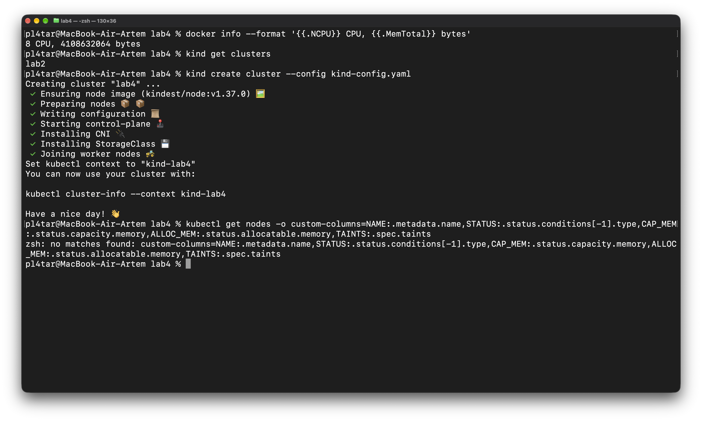 -->

### batch в чарте

Добавили шаблон `templates/deployment-batch.yaml` и секцию `batch` в values: requests 100m / 128Mi, limits 500m / 256Mi, метка `team: analytics`. Проб у `batch` нет специально т.к. у порта у него нет.

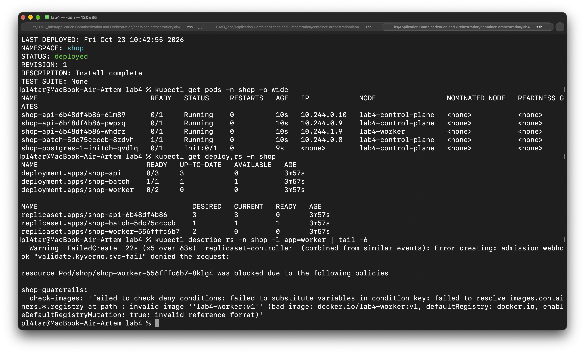

Заодно стало понятно, почему Helm пишет `deployed`. Он проверяет только, что API принял его объекты, то есть Deployment. Поды потом асинхронно создаёт ReplicaSet-контроллер, и admission-политика срабатывает на каждый Pod. Ошибка видна только в событиях ReplicaSet.

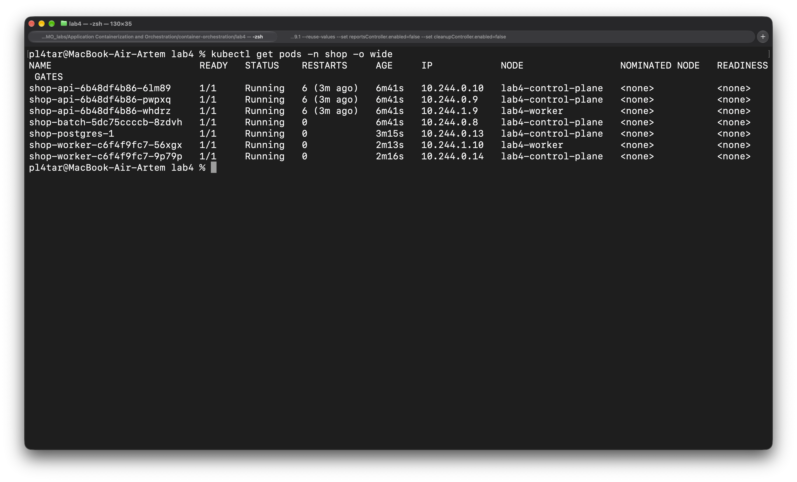

Так планировщик видит ноды:

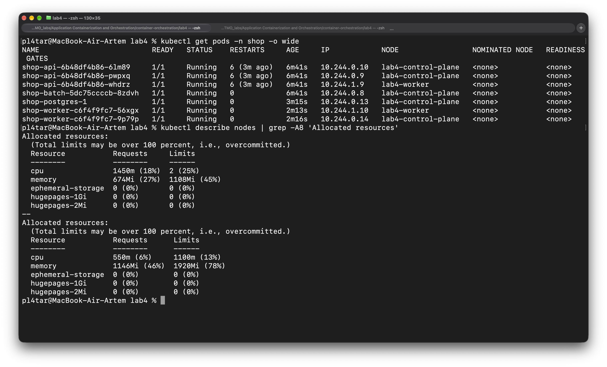

Короче, у меня ничего не работало из-за Docker Desktop, который изначально был на 3.8 GiB. Вот что мне сказала нейронка:
> Сразу после установки Kyverno, все 5 подов которого сели на control-plane рядом с etcd и apiserver, нода перевалила порог eviction, и kubelet начал выселять. Первым ушёл BestEffort `local-path-provisioner`, ReplicaSet пересоздавал его по кругу, и набралось 57 `Evicted`, то есть часть 7 случилась раньше времени. 

Подняли Docker до 5 ГБ, у Kyverno выключили `reportsController` и `cleanupController` (для enforcement гвардрейлов хватает admission-controller), и запас до порога на control-plane вырос со 140 до ~470 MiB.


---

## Часть 3 — krr vs догадка

### Нагрузка

k6 внутри кластера, открытая модель `constant-arrival-rate`, 30 RPS, 30 минут. Внутри кластера, потому что port-forward с мака идёт через apiserver и kubelet и сам становится узким местом, задержки получаются кривые. Открытая модель держит заданный RPS, даже когда `api` тормозит, а закрытая (N VU в цикле) сама сбросила бы темп и спрятала деградацию.

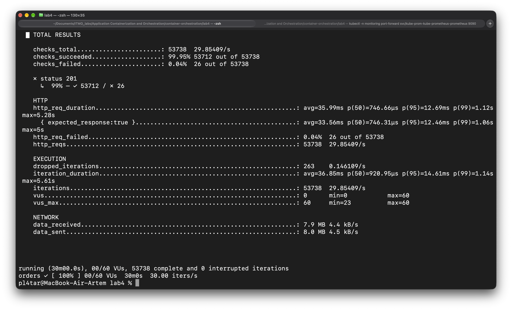

По умолчанию `krr` смотрит 14 дней истории и хочет 100 точек, а данных у нас было минут на 30, поэтому окно сузили при помощи флагов`--history_duration 1 --points_required 10`.

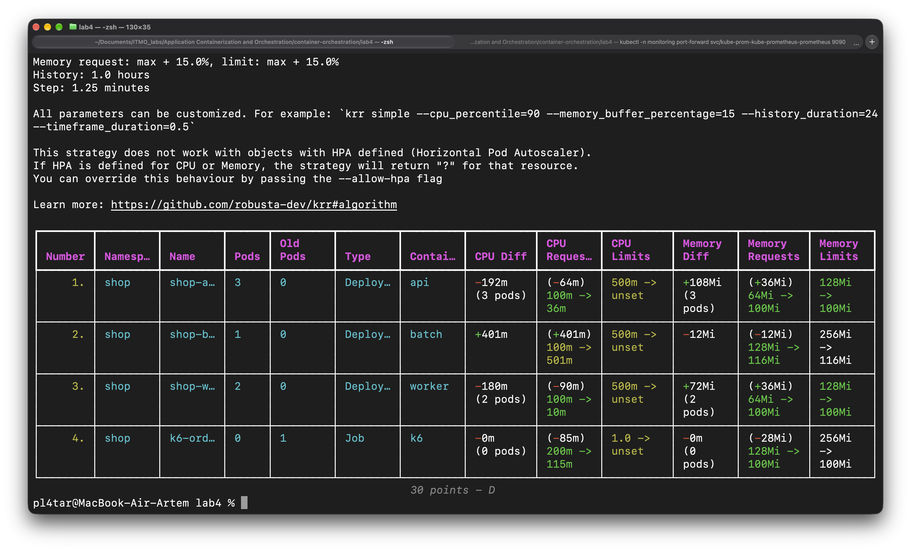

Отчёт файлом: [krr-report.csv](krr-report.csv).

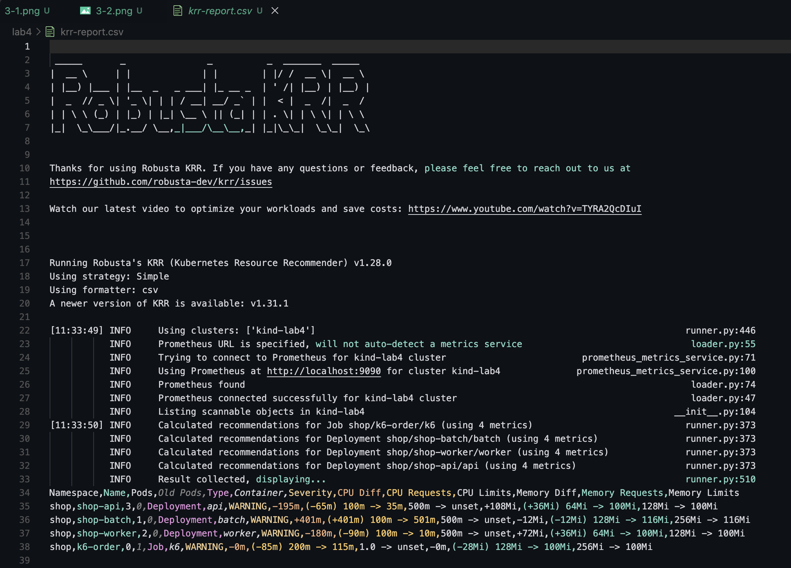

Стратегия `simple` берёт CPU request по p95, CPU limit не ставит, а memory request и limit делает равными максимуму + 15%.

### Сравнение: догадка → krr → реальность

Реальные числа сняли из Prometheus за то же окно.

| сервис | догадка (лаба 3) | krr | реально | вывод |
|---|---|---|---|---|
| api | req 100m / 64Mi, lim 500m / 128Mi | CPU 36m, memory 100Mi | P95 CPU 28–36m, max working set 13–17 MiB | 100Mi памяти это минимум krr (`--mem-min 100`), а не замер |
| worker | req 100m / 64Mi, lim 500m / 128Mi | CPU 10m, memory 100Mi | 7–9m, 11 MiB | оба числа минимумы krr (`--cpu-min`, `--mem-min`) |
| postgres | ничего (BestEffort) | нет в отчёте | P95 CPU 237m, max 164 MiB | посчитали по формуле krr сами: 240m / 189Mi |
| batch | нет | CPU 501m | 500m, троттлинг в 99% периодов | это потолок limit, о спросе цифра ничего не говорит |

Откуда расхождение:
- CPU мы завысили раза в три, а память для Go-сервисов наоборот, 64Mi было даже с запасом.
- Самый тяжёлый компонент пути, Postgres, вообще остался без ресурсов, то есть BestEffort и первый кандидат на выселение. Гвардрейлы его пропустили, потому что поды `cnpg.io/cluster` у нас в исключениях.
- `krr` не увидел Postgres. Под принадлежит не Deployment и не StatefulSet, а кастомному ресурсу CNPG `Cluster`. В README лабы 3 мы, кстати, ошибочно писали, что CNPG создаёт StatefulSet.
- Цифра у `batch` это артефакт limit. метрика показывает, сколько процессу дали. С limit в 2 ядра `krr` показал бы ~1000m, потому что одна горутина в бесконечном цикле занимает ровно ядро. (НУТИПАМЫGOРАЗРАБЫДАВОТ)

Перенесли числа в `values.yaml`. Ресурсы Postgres задаются в CR `Cluster` (`spec.resources` в `templates/cluster.yaml`), а под при изменении оператор пересоздаёт сам.

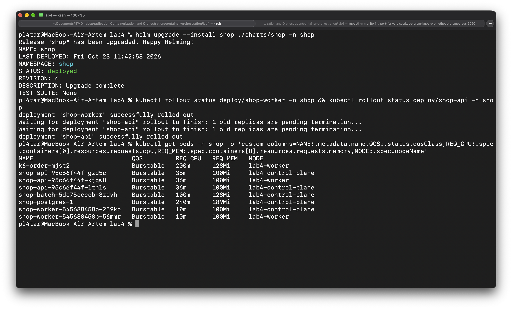

Скриншот снят до конца перезапуска Postgres, поэтому у него там ещё старый QoS.

---

## Часть 4 — Разнесение api

Шаблон `deployment-api.yaml` читает `api.spread` и рендерит либо TSC, либо anti-affinity:

```yaml
      {{- with .Values.api.spread }}
      {{- if eq .mode "topologySpread" }}
      topologySpreadConstraints:
        - maxSkew: {{ .maxSkew }}
          topologyKey: {{ .topologyKey }}
          whenUnsatisfiable: {{ .whenUnsatisfiable }}
          nodeTaintsPolicy: Honor
          labelSelector:
            matchLabels:
              {{- include "shop.api.selectorLabels" $ | nindent 14 }}
          matchLabelKeys:
            - pod-template-hash
      {{- else if eq .mode "antiAffinity" }}
      ...
```

По сравнению с частью 1 тут два новых поля.

`matchLabelKeys: [pod-template-hash]`. Во время rolling update старый и новый ReplicaSet живут одновременно, и `app=api` видит оба. Без этого поля перекос считался бы вместе со старыми подами, которые вот-вот удалят, и новая ревизия могла бы лечь криво.

`nodeTaintsPolicy: Honor`. По умолчанию стоит `Ignore`, и тогда нода с taint, на которую под всё равно не встанет, считается доменом. Пример: умер `lab4-worker`, на нём taint `unreachable`, его реплики выселены.

### Доказательство

Constraint в спецификации пода:

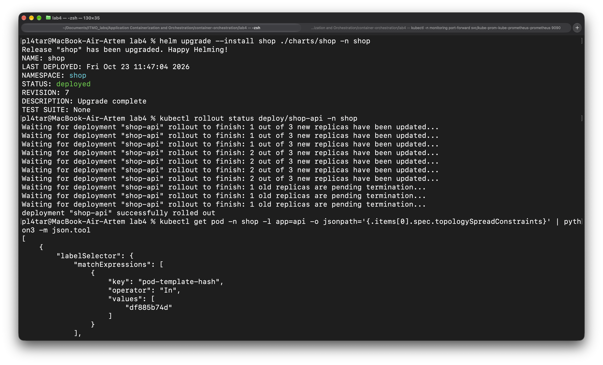
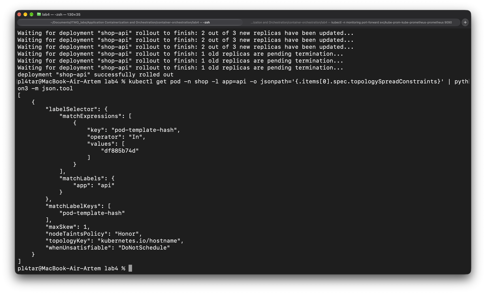

3 реплики разложились 2 + 1:

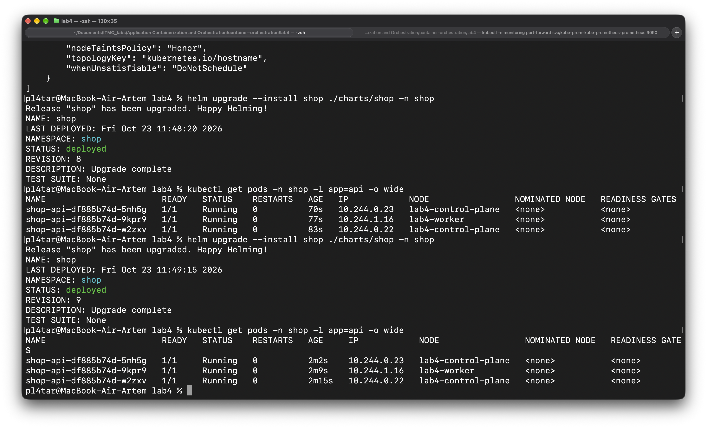

С `replicaCount: 4` строго 2 + 2. Новая реплика `2f9kw` встала на worker, потому что на control-plane перекос был бы `(2 + 1) − 1 = 2 > 1`. Хеш у неё тот же, значит, это не rolling update, ReplicaSet просто добавил под.

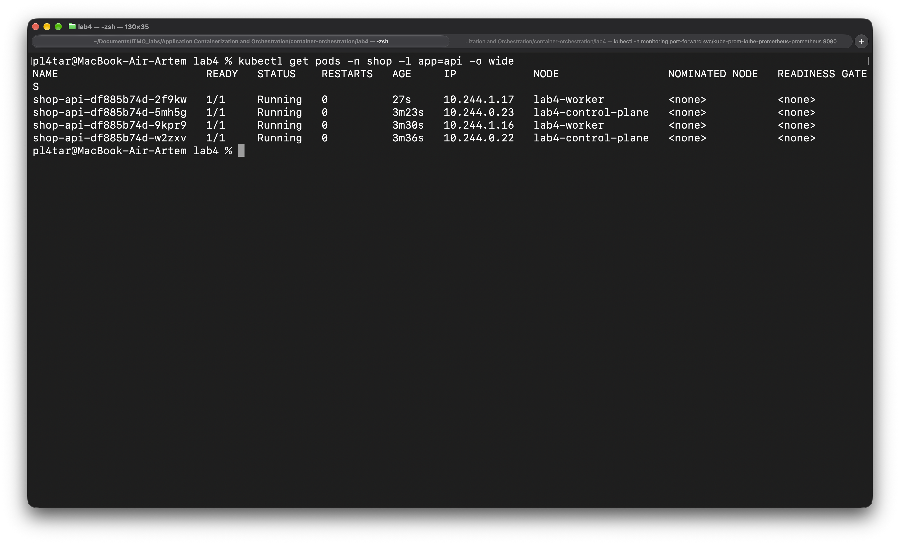

### Как это повышает отказоустойчивость?

Если падает одна нода, `api` больше не пропадает целиком: на второй гарантированно остаётся хотя бы одна реплика, и Service шлёт трафик на неё, пока выпавшие переезжают. Но если упадёт нода с двумя репликами, на время переезда останется треть мощности, так что от простоя разнесение спасает, а от деградации нет.

---

## Часть 5 — Приоритеты, QoS, PDB

Тут три разных механизма защиты, и у каждого своя ситуация:

| механизм | когда работает | кто решает | что даёт |
|---|---|---|---|
| PriorityClass | под не влезает; порядок жертв при eviction | планировщик (preemption), kubelet (порядок) | `api`/`postgres` вытесняют `batch`; при давлении `batch` уходит первым |
| QoS | давление по памяти на ноде | kubelet (eviction), ядро (`oom_score_adj`) | Guaranteed не может превысить свой request, поэтому выселяется последним |
| PodDisruptionBudget | добровольные нарушения: `drain`, Eviction API | Eviction API | `drain` не уронит больше одной реплики `api` за раз |

Шаблоны: [templates/priorityclass.yaml](charts/shop/templates/priorityclass.yaml), [templates/pdb-api.yaml](charts/shop/templates/pdb-api.yaml), плюс `priorityClassName` в шаблонах подов и в CR `Cluster`.

```yaml
priorityClasses:
  - name: shop-critical
    value: 100000
    preemptionPolicy: PreemptLowerPriority
  - name: shop-batch
    value: -10              
    preemptionPolicy: Never
```

- `api` и `postgres` сделали Guaranteed (request = limit по CPU и памяти) с классом `shop-critical`. Память взяли по `krr`. CPU сначала поставили по минутному пику с запасом, `api` 100m и `postgres` 500m, но в части 8 этого оказалось мало, и подняли до 250m и одного ядра.
- `batch` остался Burstable (requests заметно ниже limits), класс `shop-batch`.
- `worker` тоже Burstable с priority 0, где-то посередине.
- PDB для `api`: `maxUnavailable: 1`, чтобы бюджет масштабировался вместе с репликами (с `minAvailable: 2` при двух репликах drain встал бы намертво), и `unhealthyPodEvictionPolicy: AlwaysAllow`, чтобы застрявший в CrashLoop под не блокировал drain.
- PDB для `postgres` CNPG создаёт сам (`shop-postgres-primary`, `minAvailable: 1`), мы им управляем через `postgres.enablePDB`. Второй PDB на тот же под заводить нельзя, Eviction API начнёт отказывать из-за нескольких бюджетов на один под.

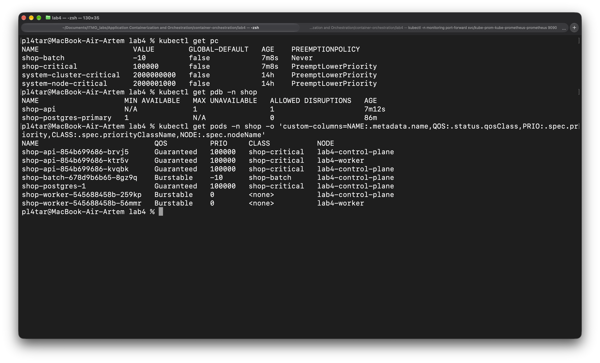

### Что даёт каждая настройка под давлением

У нас `api` и `postgres` Guaranteed с priority 100000, `worker` Burstable с priority 0, а `batch` Burstable с priority −10, то есть ниже даже мониторинга и Kyverno (у них 0). При давлении по памяти первым выселят `batch`: он может вылезти за свой request и стоит ниже всех. `api` и `postgres` превысить request не могут (limit = request), поэтому идут последними. А `preemptionPolicy: Never` не даёт `batch` самому вытеснять кого-то ради места.

PDB от выселения по давлению памяти не спасает, он срабатывает только на `drain` и Eviction API. У Postgres он с `ALLOWED DISRUPTIONS: 0`, так что `drain` ноды с ним зависнет, пока под не удалят руками или не запустят drain с `--disable-eviction`. Для БД с одним инстансом так и надо: реплики нет, и простой лучше принимать осознанно.

---

## Часть 6 — Pending и preemption


| нода | allocatable | занято requests | свободно по requests |
|---|---|---|---|
| control-plane | 2459Mi | 971Mi | ~1490Mi |
| worker | 2459Mi | 1346Mi | ~1110Mi |

По расчёту при 256Mi влезает 6 + 4 = 10 подов. Подняли `batch.replicaCount` до 12, и два остались в `Pending`, всё сошлось:

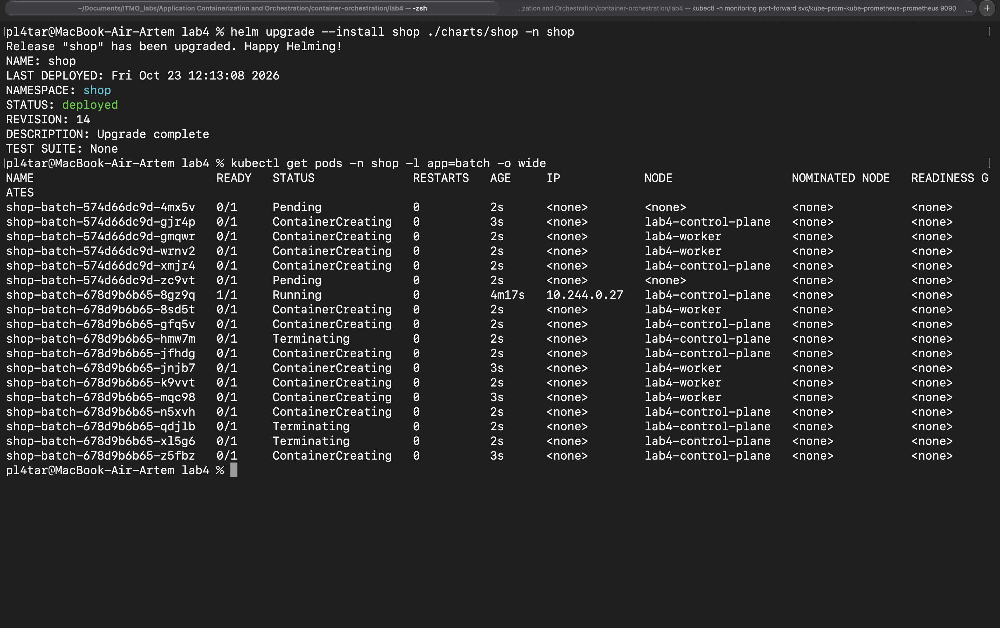

Не влезли из-за `NodeResourcesFit` по requests, а preemption даже не пробовался, потому что `preemptionPolicy: Never`:

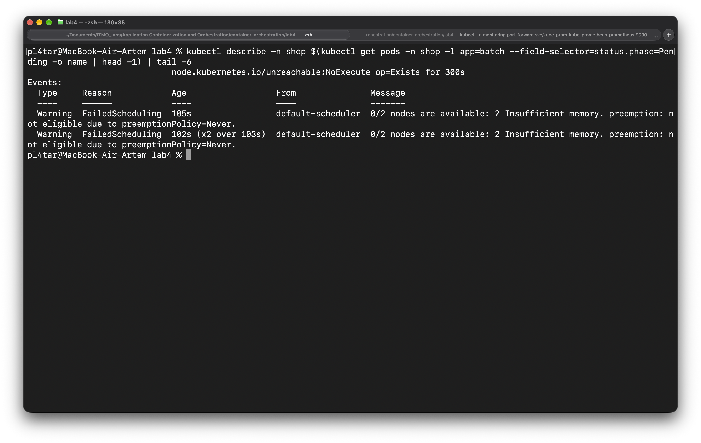

Что планировщик считает по requests, видно по цифрам. Requests на обеих нодах 96%, а все `batch` реально держат 64 и 46 MiB, и до порога eviction ещё 460 и 588 MiB:

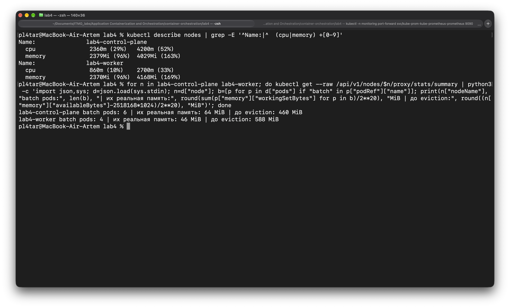

Планировщик резервирует по requests, kubelet смотрит на факт. Решай планировщик по факту, любой под, который сейчас простаивает, а через минуту вырастет, ломал бы все гарантии размещения.

### Preemption

Подняли `api.replicaCount` до 4. TSC пускает четвёртую реплику только на `lab4-worker`, а там по requests места нет. Планировщик выставил поду `NOMINATED NODE = lab4-worker`, вытеснил один `batch`, и секунд через 8 `api` стал `Running`. Замена `batch` тут же снова ушла в `Pending`.

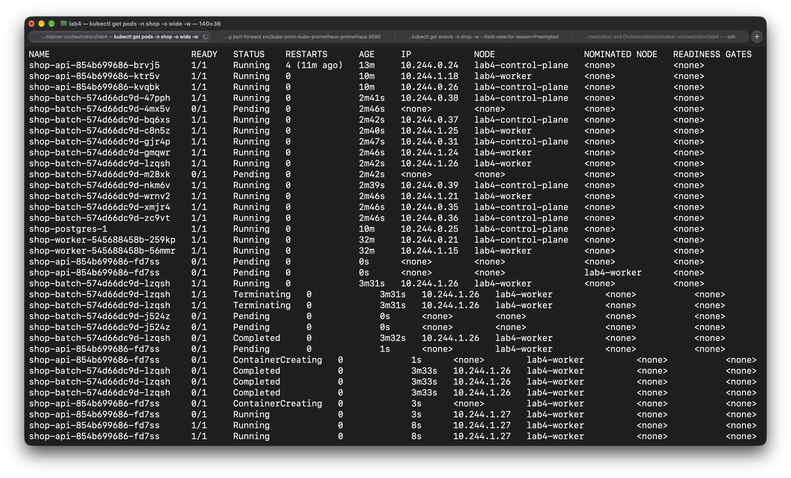
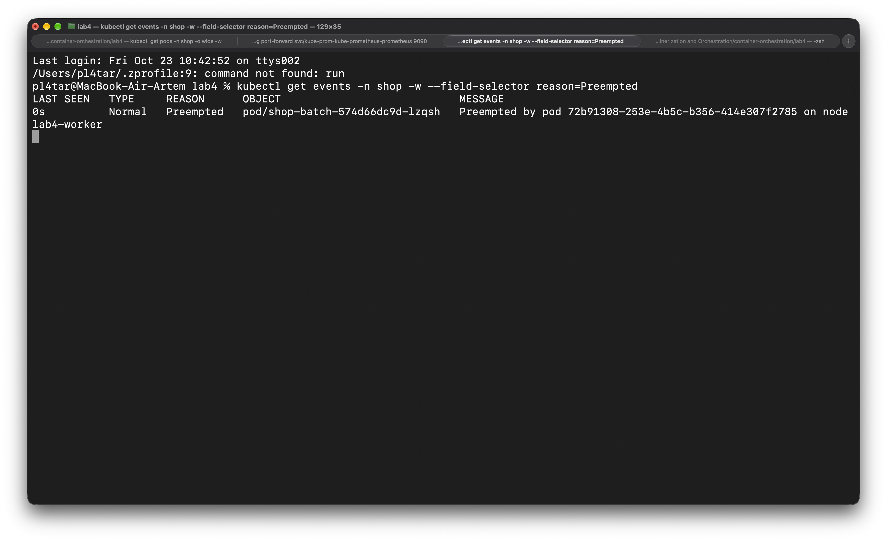

Вытеснили `batch` именно на worker, потому что на control-plane уже стоят 2 реплики `api`, и сколько `batch` оттуда ни убирай, TSC четвёртую туда не пустит (`(2 + 1) − 1 = 2 > 1`). Убрали ровно один под, столько, сколько нужно для места. А `Completed` у вытесненного `batch` потому, что preemption удаляет под обычным путём через SIGTERM, а `batch` на него выходит с кодом 0.

## Часть 7 — Eviction по памяти и OOMKilled

### Подготовка

Свободной памяти в VM Docker было ~980 MiB, а запасы до порога у нод 453 и 571 MiB, то есть инвариант 50% работает впритык. Дави мы на обе ноды сразу, VM кончилась бы раньше, чем kubelet что-то заметил. Поэтому давили одну ноду: закрепили `batch` на `lab4-control-plane` через `batch.nodeSelector` в values. Заодно тест честнее, там же стоят `postgres` и 2 из 3 `api`.

Values для давления: 12 реплик, request 64Mi, limit 512Mi, `memMB: 100`, рост около 1 MB/с на под. Медленно, чтобы kubelet с его циклом ~10 с не проскочил порог.

### Eviction

Нода ушла в `MemoryPressure`, kubelet начал выселять `batch`, и в событии прямо написано, по какому критерию:

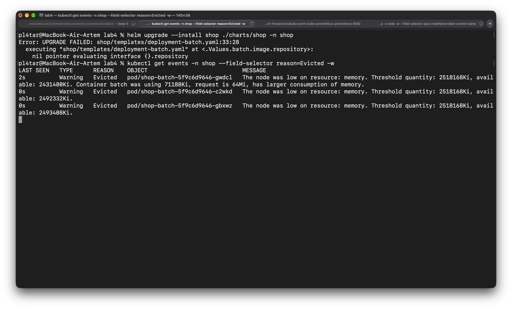

(Ошибка `helm upgrade` сверху временная: секция `batch` в values в тот момент была наполовину отредактирована, следующая ревизия выкатилась нормально.)

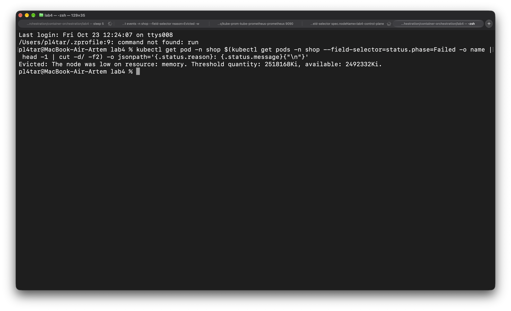

Критический путь на той же ноде не задело, рестартов у `postgres` и `api` не прибавилось:

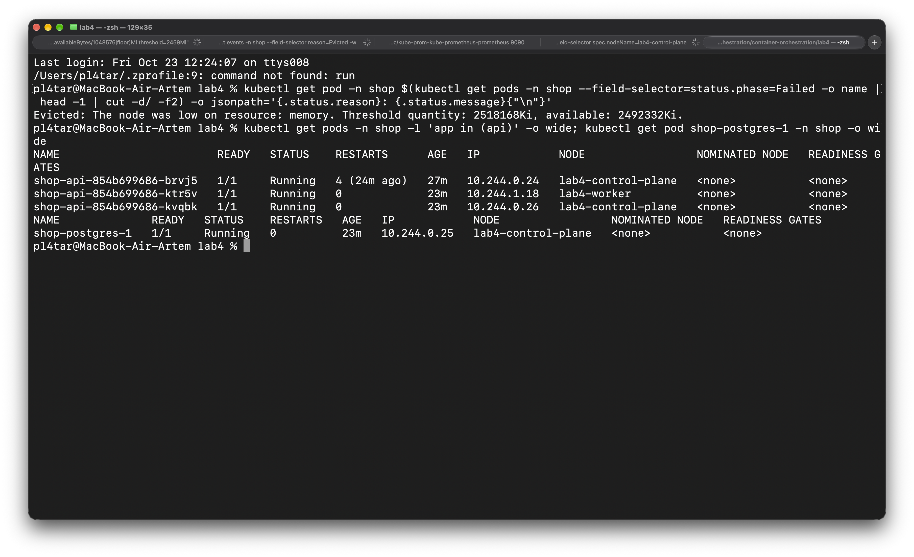

Первым ушёл `batch`, потому что у него usage больше request (первая группа) и priority −10, ниже всех. У Guaranteed `postgres` и `api` usage просто не может превысить request.

Карусели «выселили, поставили обратно, снова выселили» не было, пока держалось давление. На ноде висел taint `node.kubernetes.io/memory-pressure:NoSchedule`, и замены стояли в `Pending` с `untolerated taint`. Kubelet держит давление ещё минут 5 после того, как память вернулась (`evictionPressureTransitionPeriod`), а потом замены встали, и цикл повторился.

### OOMKilled по собственному лимиту

Для сравнения запустили один `batch` на worker: limit 256Mi, хочет 400 MB, растёт по 50 MB/с. Нода при этом спокойна (запас ~750 MiB), kubelet в процессе не участвует. Контейнер упирается в `memory.max` своей cgroup, и его убивает OOM-killer ядра. Имя пода то же, растёт `RESTARTS`:

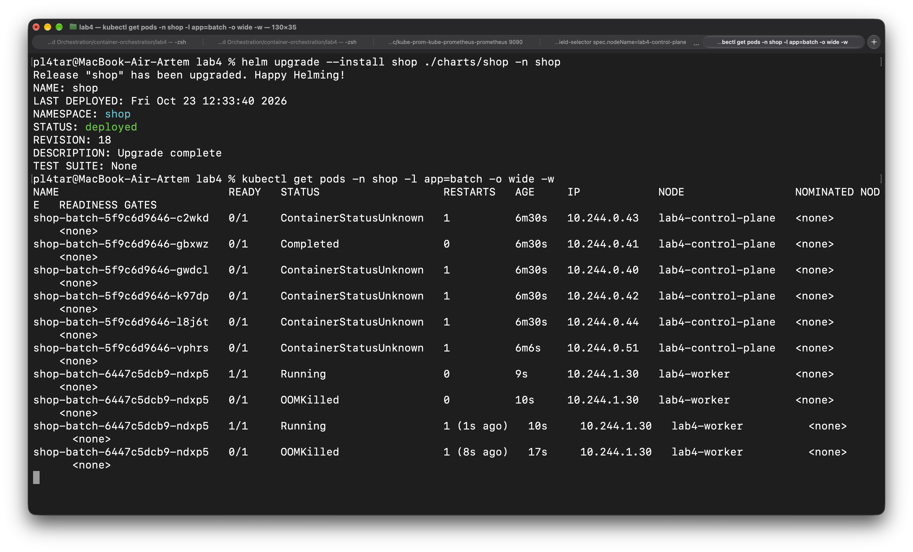
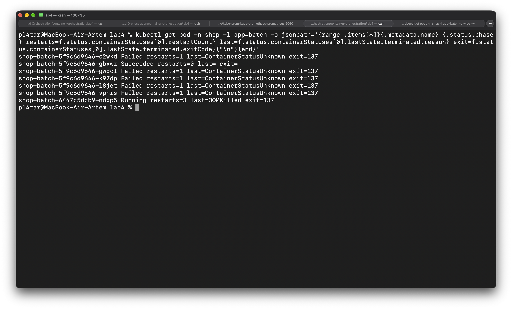

На последнем скриншоте сразу видны оба диагноза с одинаковым симптомом «под умер, памяти не хватило»:

| | Evicted | OOMKilled |
|---|---|---|
| кто убивает | kubelet | ядро, OOM-killer cgroup |
| из-за чего | нода ниже порога `memory.available` | контейнер упёрся в свой `limits.memory` |
| что с подом | под `Failed` с `reason: Evicted`, объект остаётся, ReplicaSet создаёт новый | под тот же, контейнер перезапускается, растёт `RESTARTS` |
| где смотреть | `status.reason` / `status.message` пода, события `Evicted` | `lastState.terminated.reason: OOMKilled` |
| как лечить | приоритеты и QoS, разгрузка ноды | поднять limit или чинить утечку |

Exit code 137 есть в обоих случаях. Порог у нас жёсткий (`evictionHard`), при нём kubelet не даёт grace period и сразу шлёт SIGKILL, так что по exit-коду диагноз не поставишь, смотреть надо на `reason`.

---

## Часть 8 — SLA под нагрузкой

### Формулировка

> 95% заказов (`POST /order`) обрабатываются быстрее 100 ms в любом 5-минутном окне, ошибок меньше 1% в любой минуте, в том числе пока `batch` выселяют по давлению памяти.

Порог 100 ms стоит на границе бакета гистограммы (`DefBuckets`: …0.05, 0.1, 0.25…). `histogram_quantile` интерполирует внутри бакета, поэтому SLA на границе проверяется честно. 
### Прогон 1: SLA сломался

Гоняли тот же сценарий частей 6–7 под нагрузкой k6:

| время | что происходило | p95 `/order` | ошибки | CPU VM | троттлинг Postgres |
|---|---|---|---|---|---|
| 12:18–12:26 | 9–10 `batch` × 500m (часть 6) | 0.2–7 s | 0–17% | 65–84% | 3–66% |
| 12:28–12:33 | 12 `batch`, давление памяти (часть 7) | 4–9 s | до 57% | до 93% | до 96% |
| после | `batch` спокоен | 31 ms | 0% | ~35% | 7% |

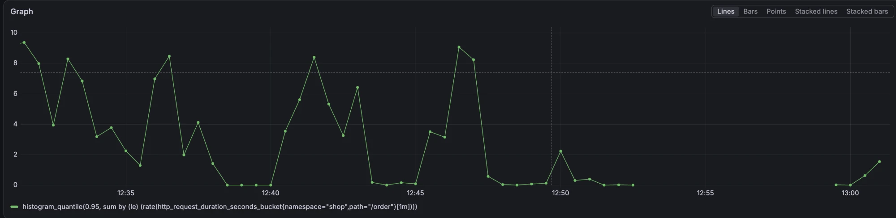
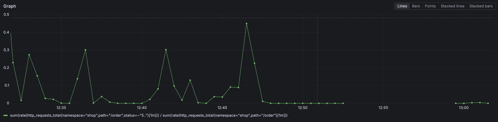
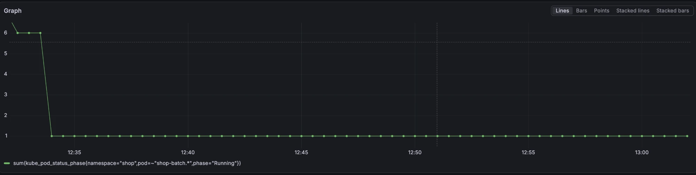
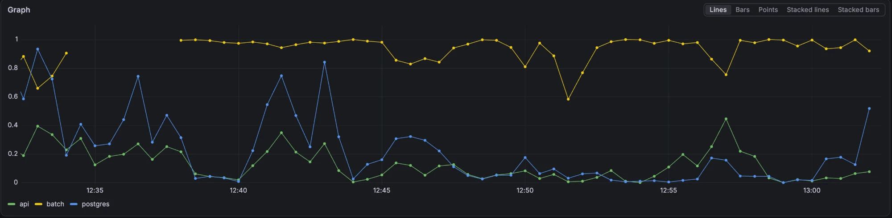

Ошибки 500 тут это `insert failed`: k6 рвёт запрос по таймауту 5 s, контекст в `api` отменяется, и INSERT падает. Получается, все ошибки это переросшая задержка.

Мы-то ждали проблем с памятью, а сломалось на CPU. От памяти защитились правильно, никого из критического пути не выселили. А у CPU свои механизмы, и с ними было две беды.

Выходит, что Guaranteed гарантирует память, а по CPU даёт только вес по request и жёсткий потолок по limit, и низкий потолок делает хуже.

Поправили: `api` 250m/250m, `postgres` 1/1 (оба по-прежнему Guaranteed), у `batch` request 50m, чтобы вес в CFS был маленький, и limit 200m, чтобы 12 подов съедали максимум 2.4 ядра вместо 6.

### Прогон 2: упал Postgres

На базовой линии второго прогона p95 снова полез до 1.5–2.2 s, и причина нашлась в статусе контейнера:

```
restarts=1  last: reason=OOMKilled  exitCode=137  finishedAt=10:01:26Z
```

Postgres умер по своему limit 189Mi, ровно как мы гадали в вопросе к части 3. Limit был посчитан по 30 минутам данных, пока таблица `orders` была маленькой. К этому моменту в ней набралось 106 тыс. строк, `shared_buffers` (128MB) заполнялись, а worker на каждом проходе читал индекс почти целиком. По минутным точкам Prometheus working set выглядел как ~135 MiB, но всплески между скрейпами доходили до лимита. Подняли до 384Mi.
### Прогон 3: SLA держится

15 минут k6: 3 минуты базы, потом давление (12 `batch` по 100 MB на control-plane) на 8 минут, отбой и восстановление.

| минута | фаза | p95 (1m) | ошибки | Running `batch` | троттлинг Postgres |
|---|---|---|---|---|---|
| 25–28 | база | 5 ms | 0% | 1 | ~0 |
| 28–36 | давление | ~5 ms, пики до 0.97 s и 0.21 s в моменты выселения | 0, всплеск 0.4% | 14 → 7 → 12 | 0–8% |
| 37–39 | восстановление | 5 ms | 0% | 1 | ~0 |

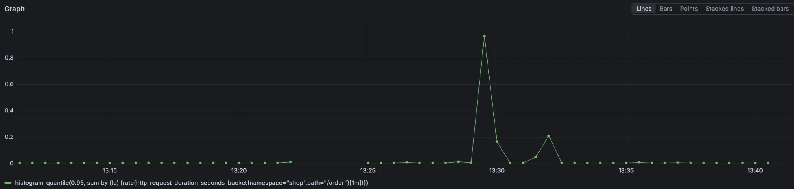
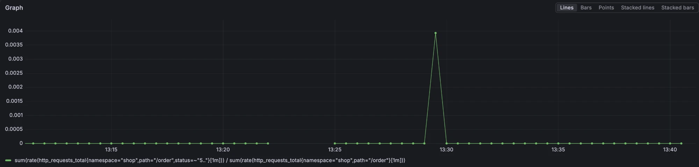
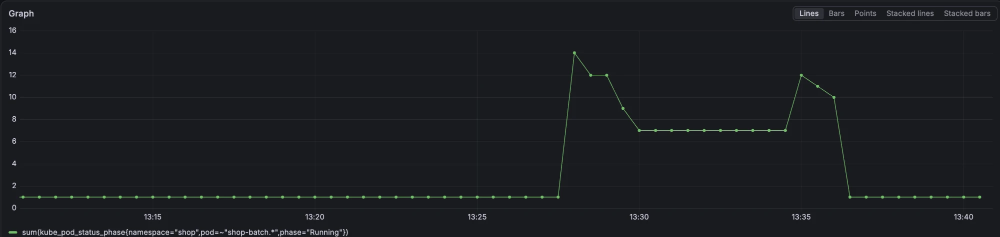
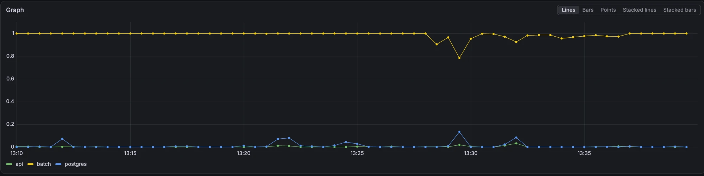

Со стороны клиента (k6):

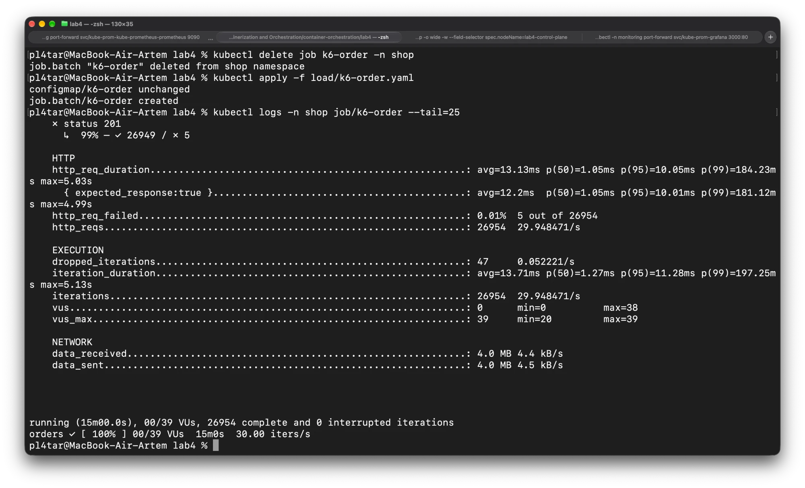

Проверили SLA с шагом 15 s, как считает Grafana:

| метрика | худшее значение | SLA |
|---|---|---|
| доля быстрее 100 ms, окно 5 мин | 96.2% | ≥ 95% |
| p95, окно 5 мин | 56 ms | ок |
| ошибки, окно 1 мин | 0.4% | < 1%  |
| p95, окно 1 мин | 0.97 s |  нет, поэтому окно и не минутное |

Критический путь не пострадал: рестартов у `postgres` и `api` не прибавилось, троттлинг у них около нуля (в первом прогоне у Postgres было 96%). Деградирует `batch`: kubelet выселил половину подов, а оставшиеся упираются в свой limit 200m, троттлинг 92–100%.


У клиента p95 10 ms, а по гистограмме `api` около 5 ms. Разница уходит на сеть и kube-proxy, гистограмма меряет только время внутри обработчика, так что SLA лучше подтверждать с обеих сторон.

Почему окно 5 минут. В минуту первой волны выселений (13:29–13:30) задержка подскочила почти до секунды: kubelet убивал `batch`, ядро освобождало память на ноде, где живёт Postgres, и всё на ноде на несколько секунд вставало. SLA/SLO в жизни считают на длинных окнах, а минутное ловит единичную остановку ноды. Эту остановку записываем в ограничения стенда: обе ноды в одной VM, и давим мы именно ноду с Postgres. В проде `batch` уехал бы на отдельный пул нод через taint/toleration и не держался бы на одних приоритетах.

---

## Часть 9 — Мониторинг

Алерты и дашборд строили вокруг SLA. Три алерта из лабы 3 («реплик меньше», «worker в crashloop», «postgres не ready») сообщают о причинах, и ни один из них не сработал бы в первом прогоне части 8: все поды были Running и Ready, а пользователи получали 57% ошибок.

### Три алерта ([templates/prometheusrule.yaml](charts/shop/templates/prometheusrule.yaml))

| алерт | что ловит | severity | обоснование |
|---|---|---|---|
| `ShopOrderLatencySLOBreach` | быстрее 100 ms меньше 95% заказов за 5 мин, `for: 2m` | critical | это сам SLA, нарушение, которое видит пользователь |
| `ShopOrderErrorBudgetBurn` | 5xx на `/order` больше 1% за 5 мин, `for: 1m` | critical | вторая половина SLA, в первом прогоне было до 57% |
| `ShopCriticalPathCPUThrottled` | `api`/`postgres` упирались в CPU limit больше чем в 25% периодов за 5 мин, `for: 5m` | warning | причина, которую в части 8 мы искали полчаса; подсказывает, куда смотреть, ещё до того, как загорится SLA |

###
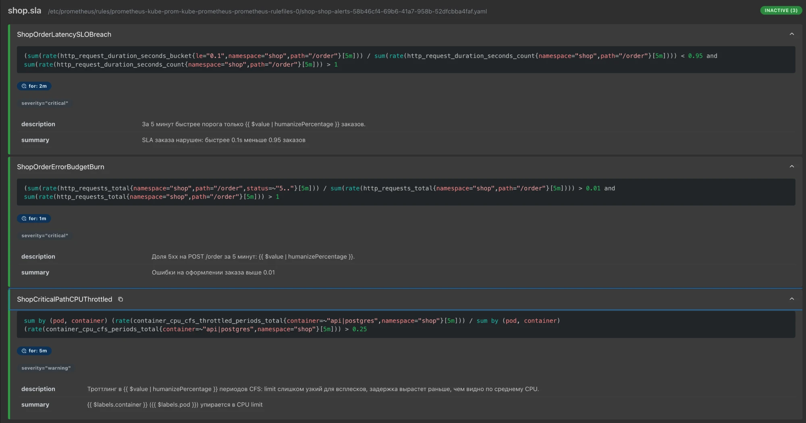

### Дашборд «shop — SLA заказа»

7 панелей: p95 (окна 1m и 5m) с линией 100 ms, SLO с линией 95%, ошибки с линией 1%, RPS по статусам, Running и желаемое число `batch`, CPU throttling и память критического пути против limit. На скриншоте окно со всеми прогонами части 8:

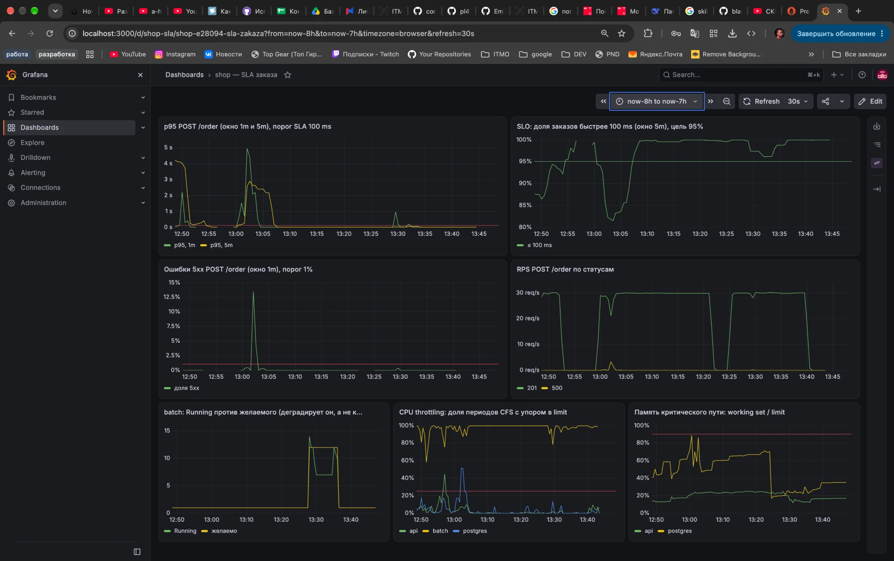

### Срабатывание

Под нагрузкой k6 удалили под Postgres (`kubectl delete pod shop-postgres-1`). 

Сначала `pending`, идёт отсчёт `for`, значение 2.04%:

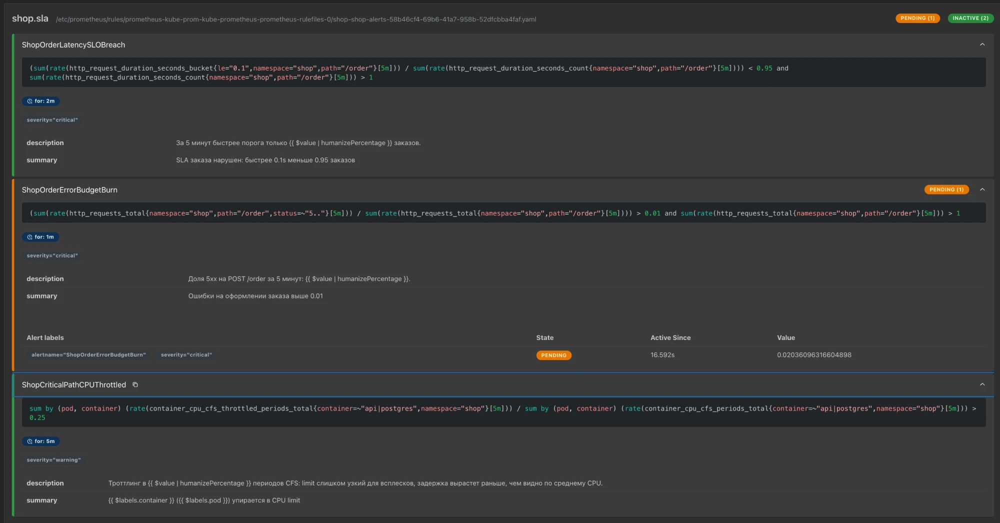

Потом `firing`:

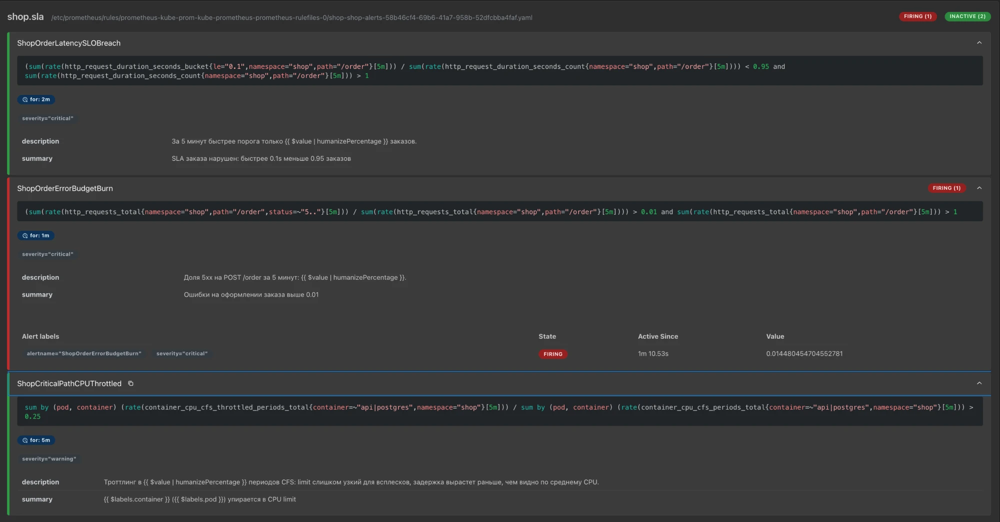

Дашборд в этот момент, ошибки выше линии 1%:

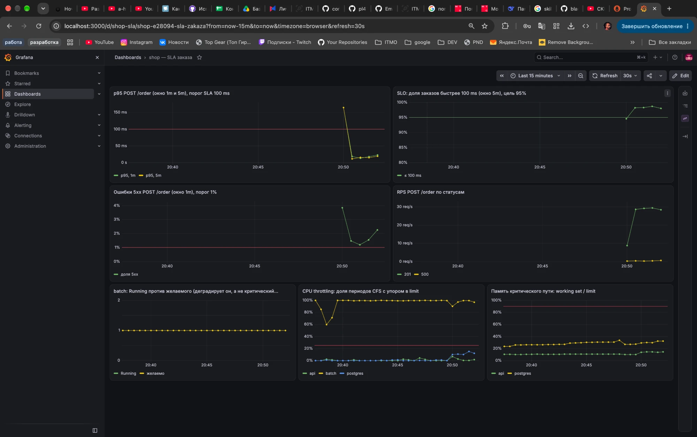

Чуть позже сработал и второй алерт. По истории `ALERTS` в Prometheus:

| алерт | pending | firing |
|---|---|---|
| `ShopOrderErrorBudgetBurn` | 20:50:29 | 20:51:29 |
| `ShopOrderLatencySLOBreach` | 20:53:29 | 20:55:29 |

Интересно, в каком порядке. Пока Postgres лежит, `api` сразу получает отказ соединения и быстро отвечает 500: ошибок много, а задержка почти не растёт (доля 5xx за 5 минут дошла до 3.85%). Когда инстанс поднимается и соединения восстанавливаются, запросы проходят, но медленно, и доля быстрых заказов за 5 минут падает до 92% при цели 95%. Поэтому алертов на SLA два, задержка и ошибки ловят разные фазы одного инцидента.

Уведомления в Telegram, как в лабе 2, в этом кластере не настраивали. Кластер лаб 2–3 мы удалили, `AlertmanagerConfig` и секрета с токеном здесь нет, а для лабы достаточно показать `firing` в UI.


# ВНИМАНИЕ!!!!!!!!!!!!!!!

# СПАСИБО ЗА ВНИМАНИЕ!
