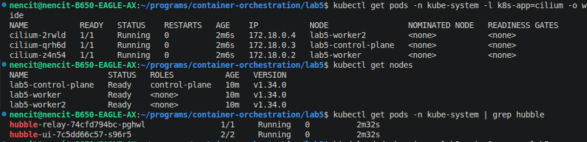
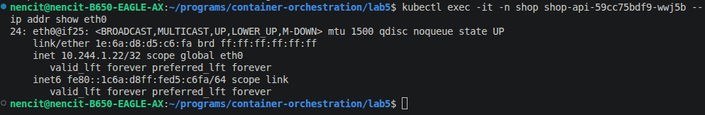
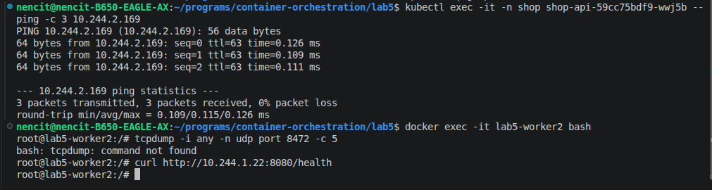
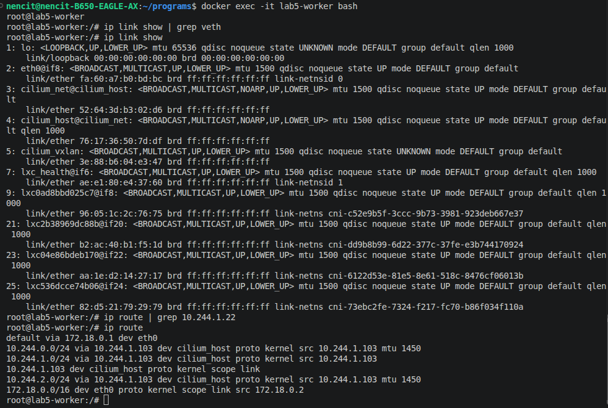
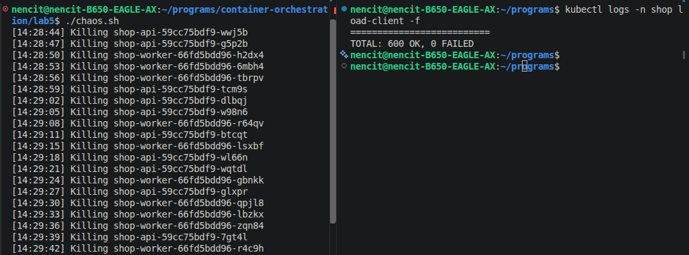
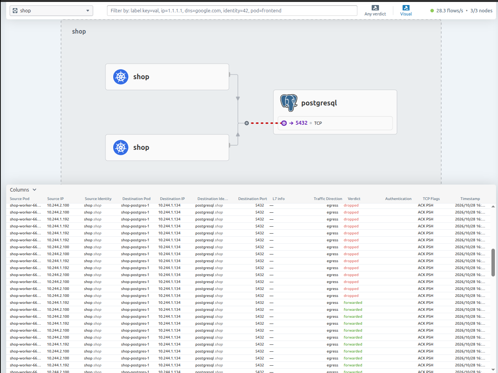
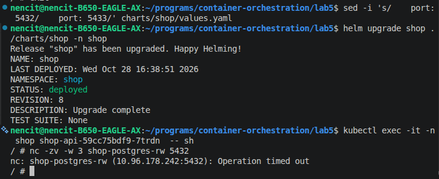
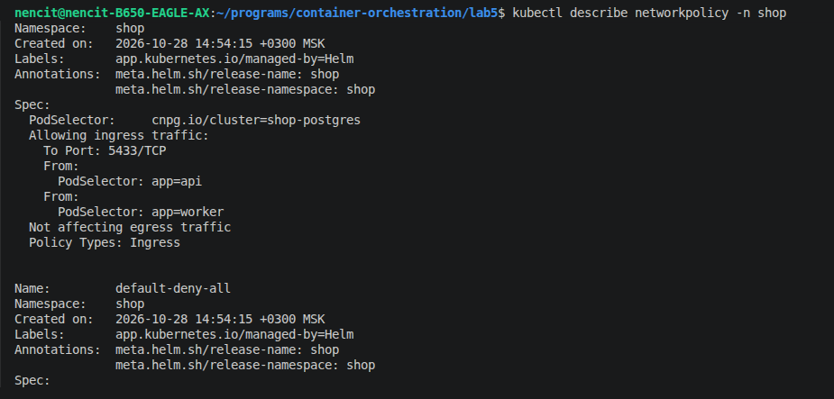
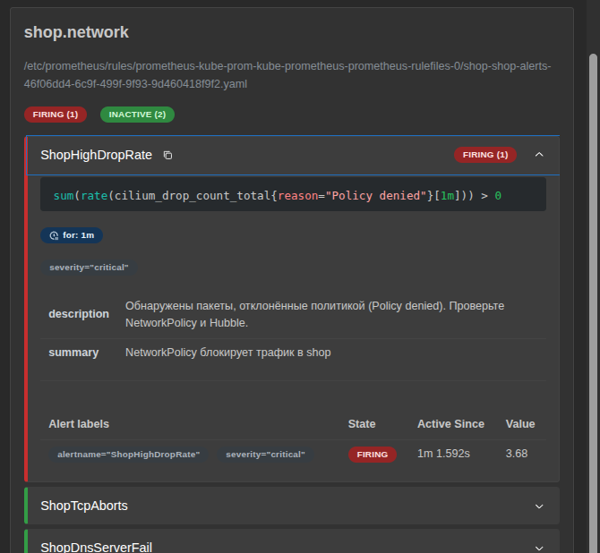
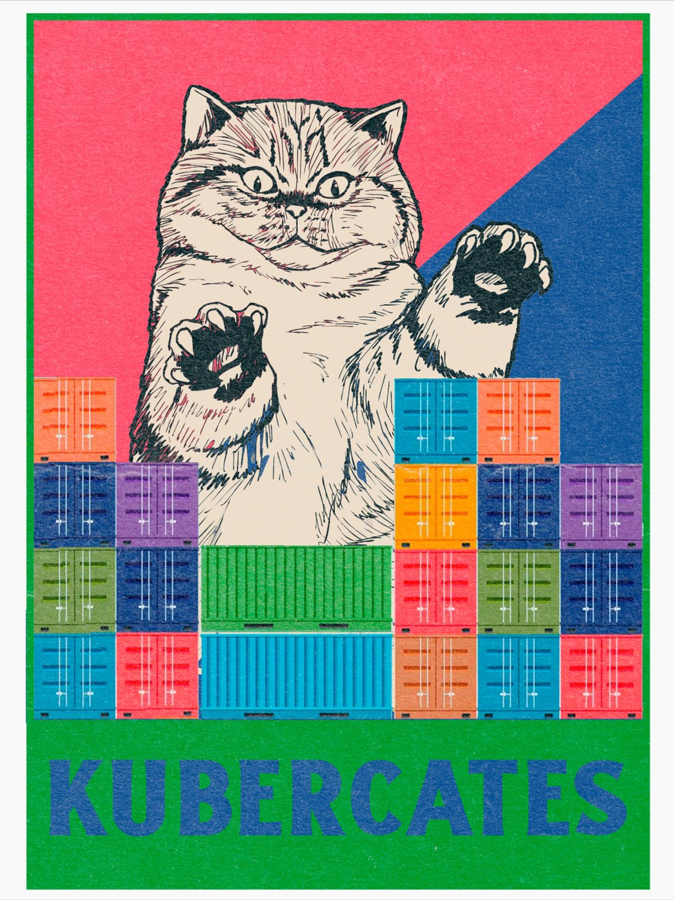

# Лаба 5 — Zero-trust сеть с доказательством

Покажем, что сеть Kubernetes это не просто «все видят всех», а управляемый механизм. Сначала мы сломаем иллюзию хрупкости подов, доказав, что Service держит удар при постоянном перезапуске отдельных подов. Потом завернём `shop` в Zero-Trust. И в финале сымитируем аварию и отыщем причину

---

## Часть 0 — Выбор CNI

Дефолтный `kindnet` не умеет применять NetworkPolicy: правила создаются, но молча игнорируются.
Выбрали **Cilium**, потому что:
1. Он работает на eBPF
2. Он даёт **Hubble**, есть встроенная сетевая наблюдаемость. Для Calico пришлось бы поднимать сторонние инструменты.



---

## Часть 1 — Исследование сети пода

нужно залезть под капот. Развернули `shop`. Поды распределились по нодам.
Зашли в под `api` и посмотрели его интерфейсы:



У пода свой сетевой namespace, внутри он видит себя как стандартный eth0.

Зашли на ноду lab5-worker (docker exec -it lab5-worker bash) и посмотрели ip link. Там нет интерфейсов veth, зато есть пачка интерфейсов lxcXXXX:

```text
9: lxc0ad8bbd025c7@if8: <BROADCAST,MULTICAST,UP,LOWER_UP> ...
    link-netns cni-c52e9b5f-3ccc-9b73-3981-923deb667e37
```

Cilium (в отличие от стандартного bridge-плагина) создаёт lxc-интерфейсы вместо veth. Это парные концы «виртуального кабеля»: один конец в поде (eth0), другой на ноде (lxc).

Проверили связь между подом на lab5-worker и подом на lab5-worker2:



Пакеты ходят напрямую. Посмотрели ip route на ноде и обнаружили mtu 1450 и routing-mode: tunnel. Значит, Cilium упаковывает пакеты в VXLAN-оверлей.



## Часть 2 — Докажи непрерывность через хаос подов

Теперь докажем, что Service скрывает смерть подов. Вынесли api наружу через NodePort, порт 30359

Написали скрипт chaos.sh, который каждые 3 секунды убивает случайный под api или worker

Параллельно запускаем клиента внутри кластера, который шлет кучу запросов. Клиент общался с Service по DNS-имени http://shop-api/health, а не с конкретными подами.

В логах chaos.sh видно, как поды непрерывно умирают:



Клиент стучится в стабильный ClusterIP сервиса, через CoreDNS. kube-proxy подменяет адрес на реальный IP пода, беря их из EndpointSlice. Когда под умирает, контроллер мгновенно вычёркивает его из EndpointSlice. kube-proxy обновляет правила, и трафик идёт только на живые поды.

## Часть 3 — Проектирование целевой матрицы доступа
Изначально сеть плоская: любой под в кластере может достучаться до Postgres. Проектируем Zero-Trust матрицу:

|От кого |	К кому |	Порт |	Разрешено?  |
|---|---------|--------------|--------|
|Внешний клиент |	api |	8080 |	 Да |
|api |	postgres |	5432 |	 Да |
|worker |	postgres |	5432 |	 Да |
|Любой под (DNS) |	CoreDNS (kube-system) |	53 |	 Да (жизненно необходимо) |
|Посторонний под (Alien) |	postgres |	5432 |	 Запрещено |
|Посторонний под (Alien) |	api |	8080 |	 Запрещено |

## Часть 4 — Включи zero-trust

Реализовали матрицу через NetworkPolicy, заодно вынеся порты в values.yaml - чтобы потом можно было сломать

- Default Deny: podSelector: {} — запрещает весь трафик в namespace shop
- DNS: разрешаем Egress на порт 53 в namespace kube-system
- API Ingress: разрешаем входящий на порт 8080 для подов app: api
- Postgres Ingress: разрешаем входящий на порт 5432 только от подов app: api и app: worker
- Postgres Egress: разрешаем подам api и worker исходящий на порт 5432 к подам Postgres

После применения helm upgrade не забыли, что ответный трафик пропускается автоматически, поэтому отдельно разрешать Egress из базы не нужно. Cilium транслирует эти YAML-правила в eBPF-программы.

## Часть 5 — Докажи матрицу на практике
Запустили под-«плохиш» (alien), у которого нет нужных меток. Проверили матрицу с помощью утилиты nc

|Проверка	|Команда	|Ожидаемо	|Фактически	|Статус|
|---|---------|--------------|--------|------|
| API → DB	|nc -zv shop-postgres-rw 5432 (из пода api)	| Открыто	| open	| ✅ | 
| Alien → DB	| nc -zv shop-postgres-rw 5432 (из alien)	| Блок	| Operation timed out	| ✅ |
| Alien → API	| wget http://shop-api/health (из alien)	| Блок	| download timed out	| ✅ |
| Alien → DNS	| nslookup shop-postgres-rw (из alien)	| Разрешено	| IP резолвится	| ✅ |
| Внешний → API	| curl http://<NodeIP>:30359/health	| Разрешено	| 200 OK	| ✅ |

Ура все работает, едем дальше

```bash
nencit@nencit-B650-EAGLE-AX:~/programs/container-orchestration/lab5$ kubectl exec -it -n shop alien -- sh
/ # nc -zv -w 3 shop-postgres-rw 5432
nc: shop-postgres-rw (10.96.178.242:5432): Operation timed out
/ # wget -qO- --timeout=3 http://shop-api/health
wget: download timed out
/ # nslookup shop-postgres-rw
Server:         10.96.0.10
Address:        10.96.0.10:53


** server can't find shop-postgres-rw.cluster.local: NXDOMAIN

** server can't find shop-postgres-rw.svc.cluster.local: NXDOMAIN

** server can't find shop-postgres-rw.svc.cluster.local: NXDOMAIN

** server can't find shop-postgres-rw.cluster.local: NXDOMAIN

Name:   shop-postgres-rw.shop.svc.cluster.local
Address: 10.96.178.242

** server can't find shop-postgres-rw.Dlink: NXDOMAIN

** server can't find shop-postgres-rw.Dlink: NXDOMAIN

/ # exit
```

```bash
nencit@nencit-B650-EAGLE-AX:~/programs/container-orchestration/lab5$ kubectl exec -it -n shop shop-api-59cc75bdf9-7trdn -- sh
/ # nc -zv -w 3 shop-postgres-rw 5432
shop-postgres-rw (10.96.178.242:5432) open
/ # exit

nencit@nencit-B650-EAGLE-AX:~/programs/container-orchestration/lab5$ kubectl get nodes -o wide
NAME                 STATUS   ROLES           AGE    VERSION   INTERNAL-IP   EXTERNAL-IP   OS-IMAGE                         KERNEL-VERSION     CONTAINER-RUNTIME
lab5-control-plane   Ready    control-plane   2d2h   v1.34.0   172.18.0.2    <none>        Debian GNU/Linux 12 (bookworm)   7.0.0-38-generic   containerd://2.1.3
lab5-worker          Ready    <none>          2d2h   v1.34.0   172.18.0.4    <none>        Debian GNU/Linux 12 (bookworm)   7.0.0-38-generic   containerd://2.1.3
lab5-worker2         Ready    <none>          2d2h   v1.34.0   172.18.0.3    <none>        Debian GNU/Linux 12 (bookworm)   7.0.0-38-generic   containerd://2.1.3
nencit@nencit-B650-EAGLE-AX:~/programs/container-orchestration/lab5$ curl -i http://172.18.0.2:30359/health
HTTP/1.1 200 OK
Date: Wed, 28 Oct 2026 12:16:46 GMT
Content-Length: 2
Content-Type: text/plain; charset=utf-8

ok
```

## Часть 6 — Найди скрытую поломку связности

запускаем скрипт с поломкой breaker.sh

Сломался порт Postgres (поменял 5432 на 5433 в NetworkPolicy).

Видим: Приложение перестало подключаться к базе.

Так, теперь смотрим че где почему: 

Зашли в Hubble UI, в таблице Flow Details внизу увидели поток: Destination Port: 5432, Verdict: DROPPED, Traffic Direction: egress. Так же проверили доступ к базе отдельно




Выполнили `kubectl describe networkpolicy -n shop` и увидели, что политика разрешает порт 5433 вместо 5432.



Вернули 5432 в values.yaml, сделали helm upgrade. Hubble показал Verdict: forwarded, связь восстановилась

## Часть 7 — Мониторинг

Добавили ServiceMonitor и PrometheusRule в чарт shop (используя kube-prometheus-stack из Лабы 2).

3 алерта, завязанных на сеть:

- ShopHighDropRate (критический): sum(rate(cilium_drop_count_total{reason="Policy denied"}[1m])) > 0. Ловит любой дроп трафика из-за NetworkPolicy (признак атаки или поломки).

- ShopTcpAborts (warning): sum(rate(cilium_tcp_connection_aborted_total[1m])) > 0. Ловит аварийные обрывы TCP-соединений (проблемы с базой или сетью).

- ShopDnsServerFail (критический): sum(rate(coredns_dns_responses_total{rcode="SERVFAIL"}[1m])) > 0. Ловит отказы DNS, из-за которых сервисы не могут найти друг друга по имени.

Проверка: Постучались из alien в базу, т.е. вызвали DROP. В Prometheus UI алерт ShopHighDropRate перешел в статус FIRING через 1 минуту.




## спасиби за внимание!!

