# Лаба 6 - Автопилот релиза

Смотрим на `api` из чарта `shop`, что умеет service mesh: шифрует ли трафик, прячет ли сбои от клиента и может ли сам катить релиз. Сначала сняли точку отсчёта, потом завели `api` в mesh и собрали канарейку, которая сама откатывает плохую версию и докатывает хорошую. В конце посчитали, во сколько это обошлось.

Стенд: один узел kind на Docker Desktop (4,8 ГБ памяти, 8 ядер), `kube-prometheus-stack`, CloudNativePG. Всё разворачивается чартом `charts/shop`. Времена в логах и в тексте по UTC.

---

## Часть 0 - Сервисы

Взяли `api` из прошлых лаб и дописали ([main.go](shop/cmd/api/main.go)):

- `GET /version` отдаёт `v1` или `v2`. Образ у версий один, версию задаёт чарт через `VERSION`
- `FAIL=true` у v2: каждый `POST /order` отдаёт 500
- `FLAKY=true` у v1: 30% запросов случайно падают с 500. Падают до обращения к базе, так что повтор `POST /order` дубль заказа не создаст

Скрипт-гейт лежит в [gate/gate.py](gate/gate.py), его логика описана в Части 6.

---

## Часть 1 - Выбор mesh

Выбрали **Linkerd**. Лабе нужны retries, деление трафика и метрики по версиям, а это всё L7. В Linkerd оно есть сразу, в прокси рядом с подом. В Istio ambient `ztunnel` работает только на L4, и сверху пришлось бы ставить waypoint на Envoy. У нас ноутбук на 8 ГБ и один узел, поэтому взяли что полегче.

Платим за это прокси в каждом поде и рестартом подов при включении в mesh. В цифрах посчитали в Части 8. Поставили `edge-26.10.2` и закрепили версию: open-source проект выпускает только edge-релизы.

---

## Часть 2 - Baseline

Развернули чартом `api` v1 (2 реплики) и `postgres`, без mesh.

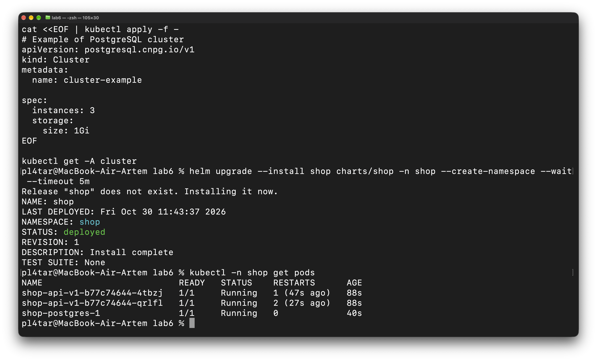

Нагрузка: [k6 внутри кластера](load/k6-order.yaml), 30 RPS на `POST /order`, 3 минуты. Модель открытая (`constant-arrival-rate`), потому что закрытая при тормозах сама сбавила бы темп и спрятала бы деградацию.

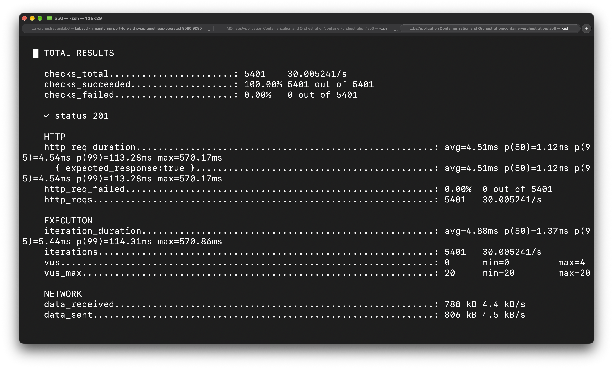

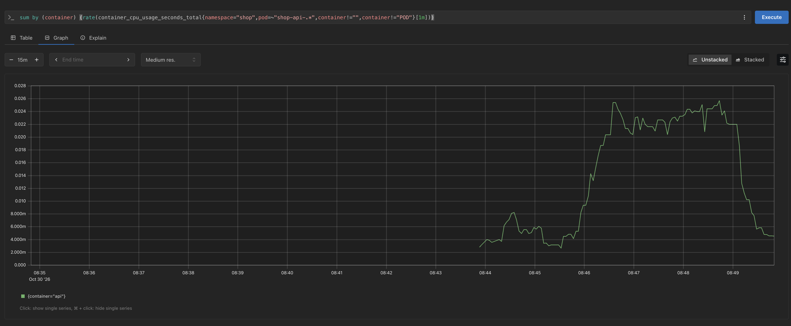

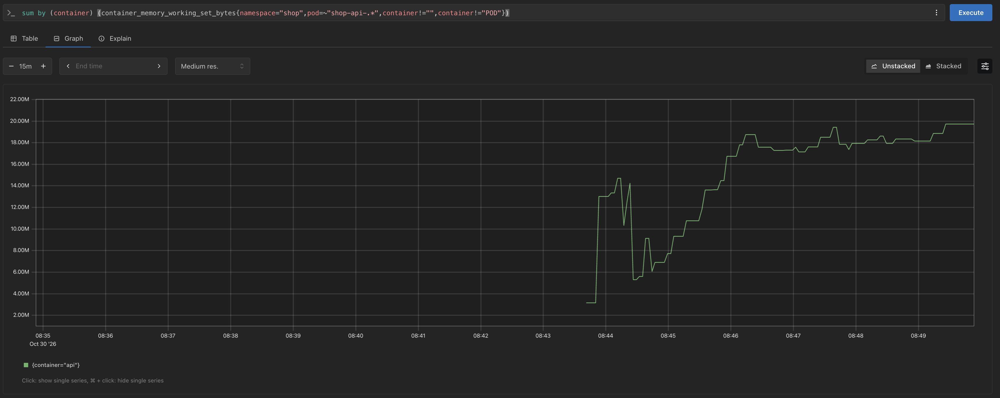

| Метрика | Значение |
|---|---|
| p50 / p95 / p99 | 1,12 / 4,54 / 113,28 мс |
| max | 570 мс |
| Ошибки | 0 из 5401 |
| CPU `api` (2 пода) | 0,023 ядра |
| RAM `api` (2 пода) | 17,5 МиБ |

Хвост p99 сидит внутри обработчика, на пути к Postgres. CPU-лимит ни при чём, троттлинг всего 0,28%.

---

## Часть 3 - mTLS

В mesh `api` заводится значениями чарта: `api.mesh.enabled` добавляет аннотацию `linkerd.io/inject`. Ещё завели отдельные ServiceAccount, `shop-api` для `api` и `load-test` для клиента. Сертификат Linkerd выдаёт по SA, и на общем `default` у клиента и сервера было бы одно имя.

Клиента тоже пришлось завести в mesh, потому что шифрует трафик его прокси. Без прокси запрос пойдёт открытым текстом.

До mesh tcpdump на `eth0` пода показывал весь заказ:

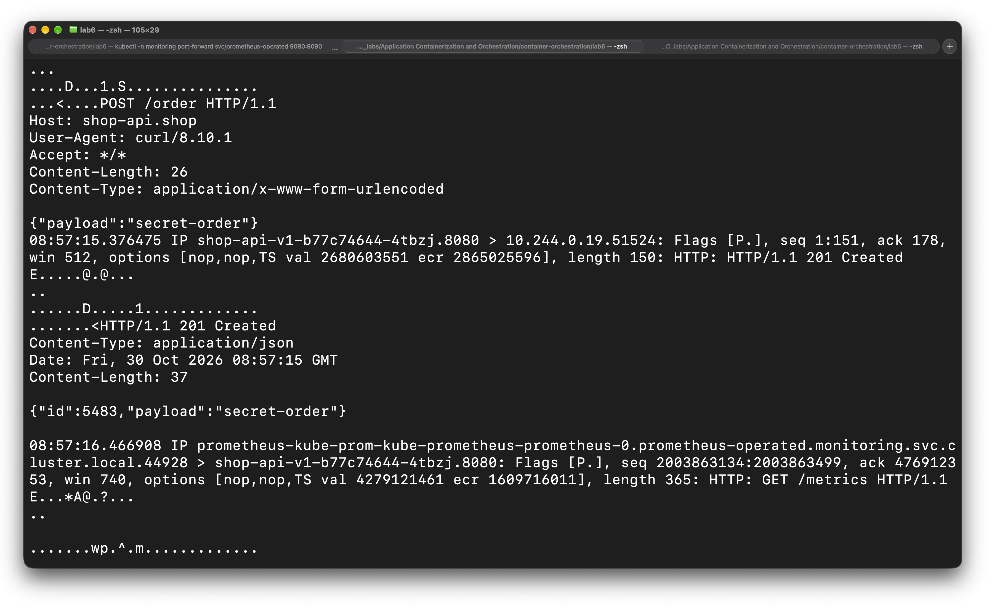

После включения `api` и клиент стали `2/2`, `postgres` остался `1/1`:

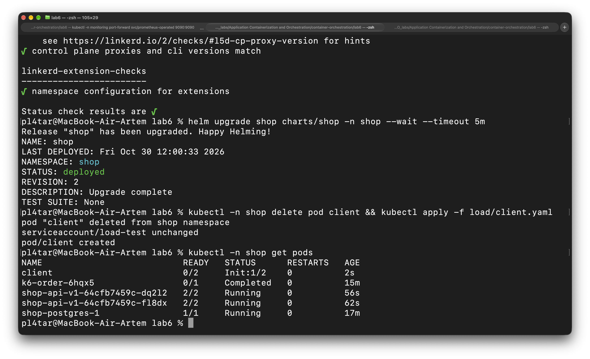

Теперь на `eth0` того же пода на порту прокси 4143 только зашифрованные `Application Data`:

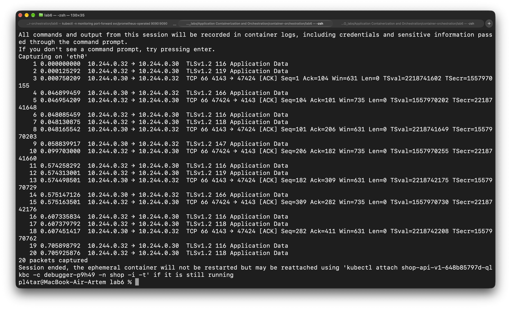

Identity подтверждается сертификатом: `CN=shop-api.shop.serviceaccount.identity.linkerd.cluster.local`, издатель `identity.linkerd`.

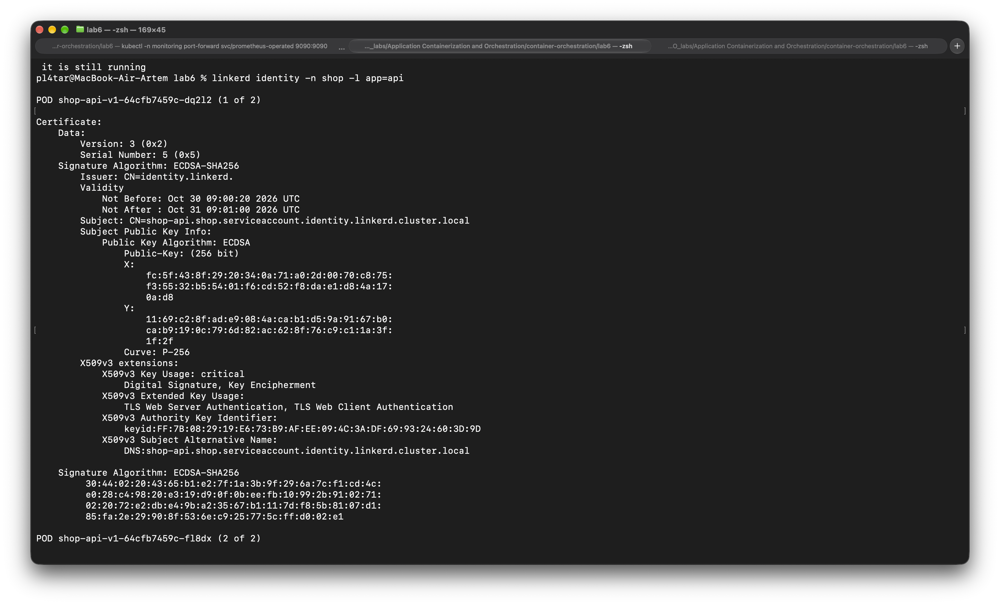

В метриках прокси клиент виден по имени из сертификата: `tls="true"`, `client_id="load-test.shop.serviceaccount.identity.linkerd.cluster.local"`.

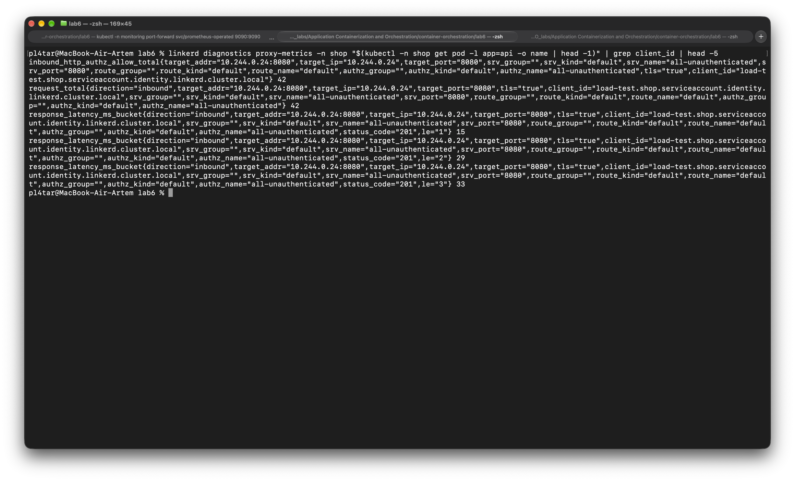

Потом временно поставили политику `all-authenticated`. Клиент с сертификатом получил 201, под без сертификата 403, значит пускает по identity, адрес тут не важен.

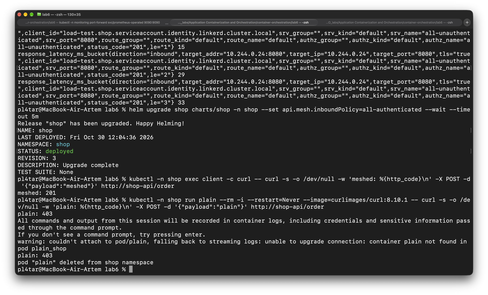

---

## Часть 4 - Надёжность бесплатно

Включили `FLAKY=true` на v1 и повесили retries на Service: `retry.linkerd.io/http: 5xx` и `retry.linkerd.io/limit: 3`. Лимит по умолчанию (1) здесь слабый, при 30% сбоев клиент видел бы 9%.

Прогон один, непрерывный, на 6 минут. Примерно 2 минуты без retries, потом включили их на лету. Поды перезапускать не пришлось, прокси клиента подхватили политику сами. На графике видно, что поменялось:

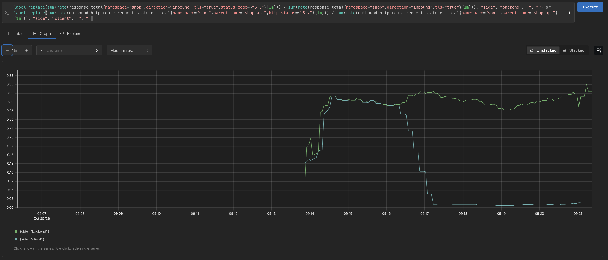

Backend всё время отдаёт около 30% ошибок, а у клиента доля падает с ~30% до значений от 0,6 до 1,4%. По расчёту должно быть 0,81% (0,3⁴). Код `api` не меняли.

Итог k6 за весь прогон: 11,03% ошибок (1186 из 10747), это смесь участка без retries и участка с ними.

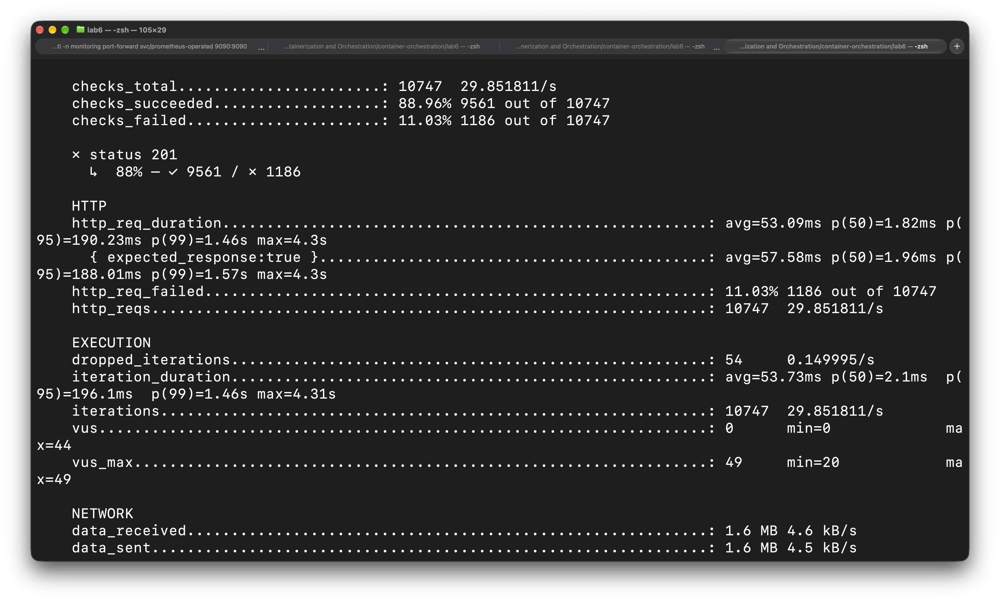

Сработали retries, и это видно по метрикам самого mesh:

- попыток на один запрос клиента стало ~1,42 вместо 1,00 (расчёт 1 + 0,3 + 0,09 + 0,027). Считали как `outbound_http_route_backend_requests_total` / `outbound_http_route_request_statuses_total`
- `outbound_http_balancer_endpoints{endpoint_state="pending"}` всё время 0, эндпоинты из балансировки не выводились

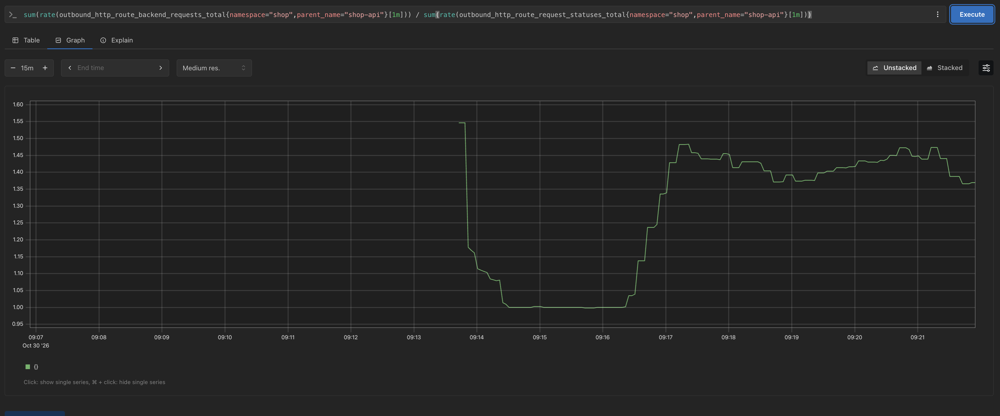

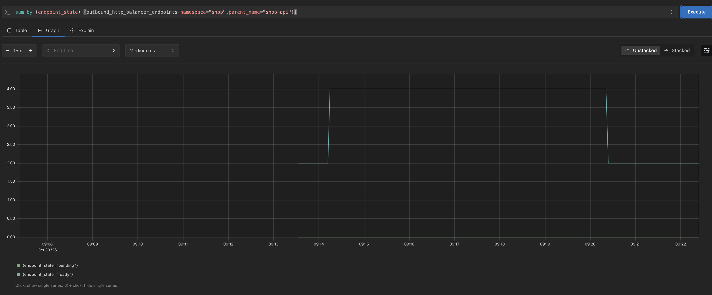

Circuit breaking не участвовал: он включается отдельными аннотациями, мы их не ставили. Да и при случайных сбоях на всех подах выводить из балансировки некого.

Минусы тоже есть. Backend получает в ~1,4 раза больше запросов, а повторы `POST` безопасны только потому, что наш `FLAKY` падает до `INSERT`. Ошибка после записи давала бы дубли заказов.

---

## Часть 5 - v1, v2 и деление трафика

Обе версии создаются из `api.versions` одним шаблоном Deployment. У каждой свой Service, потому что `backendRefs` ссылаются на Service.

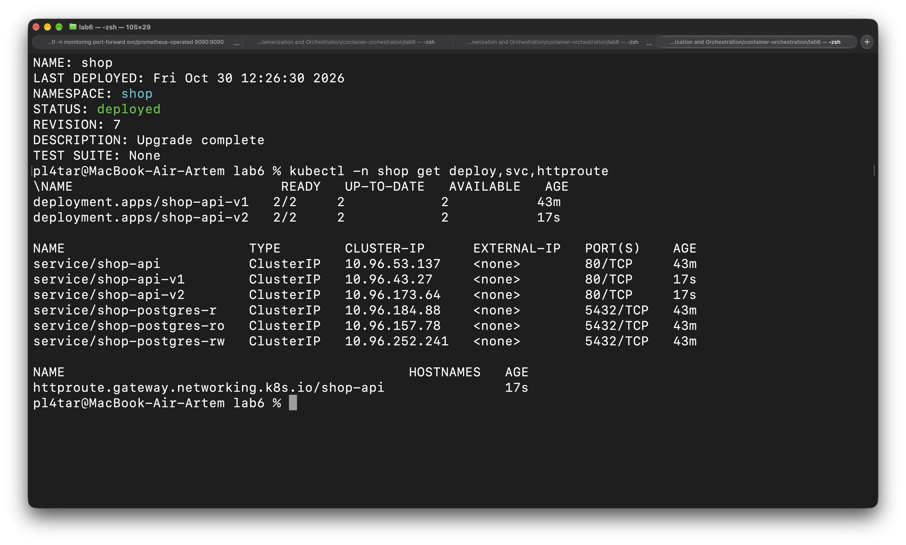

Деление задано объектом mesh ([HTTPRoute](charts/shop/templates/httproute-api.yaml)): `parentRef` на Service `shop-api` и два `backendRefs` с весами 90 и 10. Клиенты про версии не знают и ходят на тот же адрес.

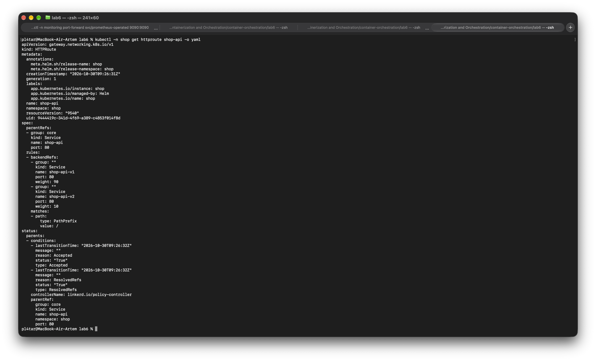

Из 1000 запросов к `/version` 905 пришло в v1 и 95 в v2:

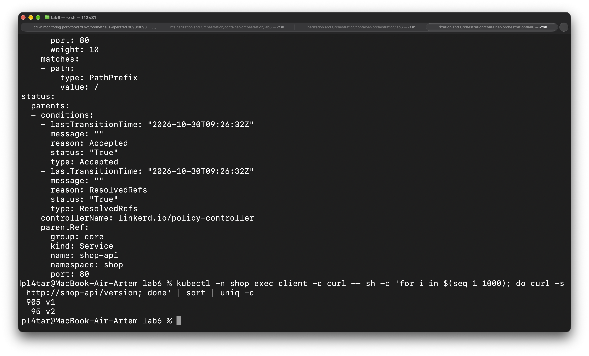

Трафик на каждый запрос делит `linkerd-proxy` в поде клиента. Поэтому клиент вне mesh обходит `HTTPRoute` и попадает на все 4 пода поровну. Проверили на 294 ответах: 137 v1 и 157 v2.

---

## Часть 6 - Автопилот

Гейт смотрит на метрики inbound-прокси самой v2 за 30 секунд: нагрузку, долю 5xx и p95. Клиентские метрики не подходят, retries прячут от них ошибки (Часть 4).

Раз в 15 секунд он решает, что делать:

| Условие | Решение |
|---|---|
| Нагрузка на v2 меньше 1 RPS или данных нет | Держим вес: отсутствие данных не доказывает, что версия здорова |
| Ошибок больше 5% или p95 больше 0,5 с | Первая проверка держит вес, вторая подряд откатывает v2 в 0 |
| Всё хорошо | +20% к доле v2 |
| Вес 0 или 100 | Релиз завершён |

Две проверки нужны из-за всплесков на стенде, иначе один всплеск откатит здоровый релиз. Веса гейт пишет в `HTTPRoute` через Kubernetes API, RBAC разрешает ему только этот маршрут. Новый релиз он определяет сам: смена настроек v2 пересоздаёт его под, и всё начинается с 10%.

---

## Часть 7 - Оба сценария

Плохой релиз (`FAIL=true`). Гейт стартовал в 09:35:03 и в 09:35:48 откатил v2 в 0, вышло 45 секунд. Сначала он успел поднять долю до 30%, потому что в окне 30 секунд ещё лежали данные старых здоровых подов. Потом увидел 100% ошибок: первая проверка держала вес, вторая откатила.

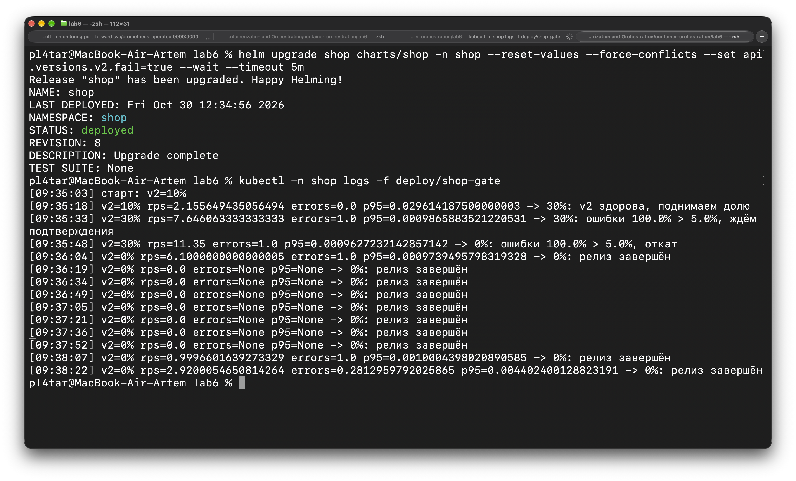

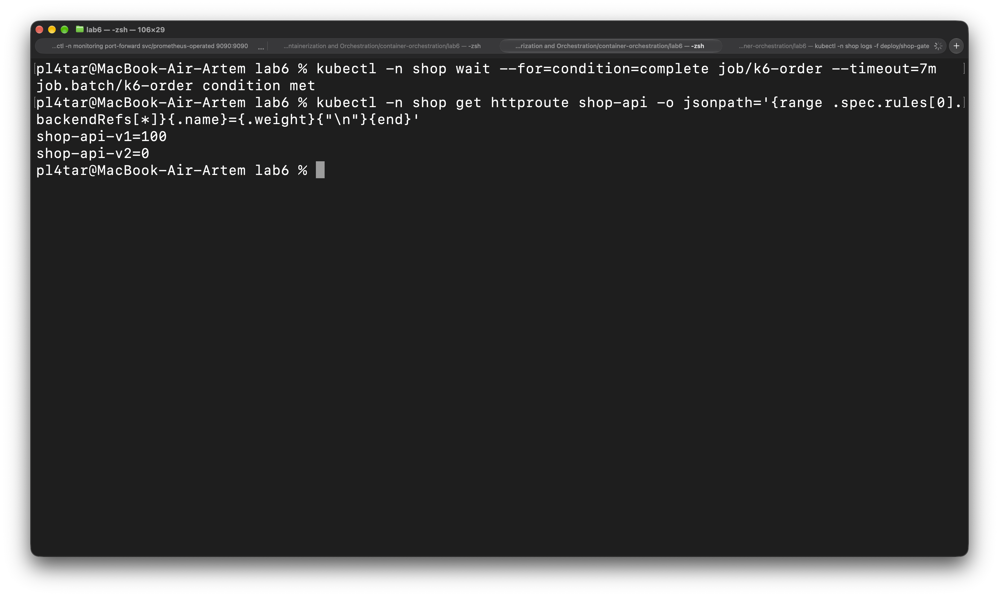

Клиенты почти ничего не заметили, максимум ~0,6% ошибок: retries уводили запросы на v1.

Хороший релиз (`FAIL=false`). С 10% до 100% за 93 секунды, с 09:38:29 до 09:40:02. На 70% разовый всплеск p95 до 0,705 с задержал шаг на одну проверку, следующая прошла чисто. Без правила двух проверок здоровый релиз откатился бы.

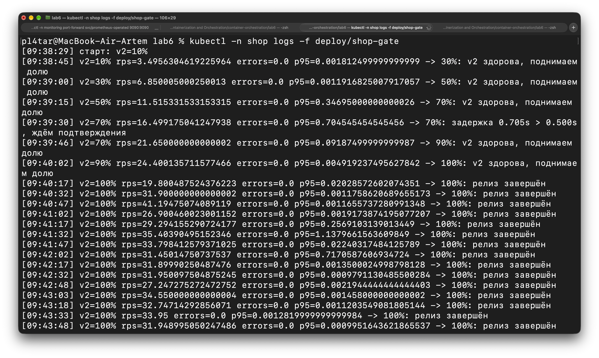

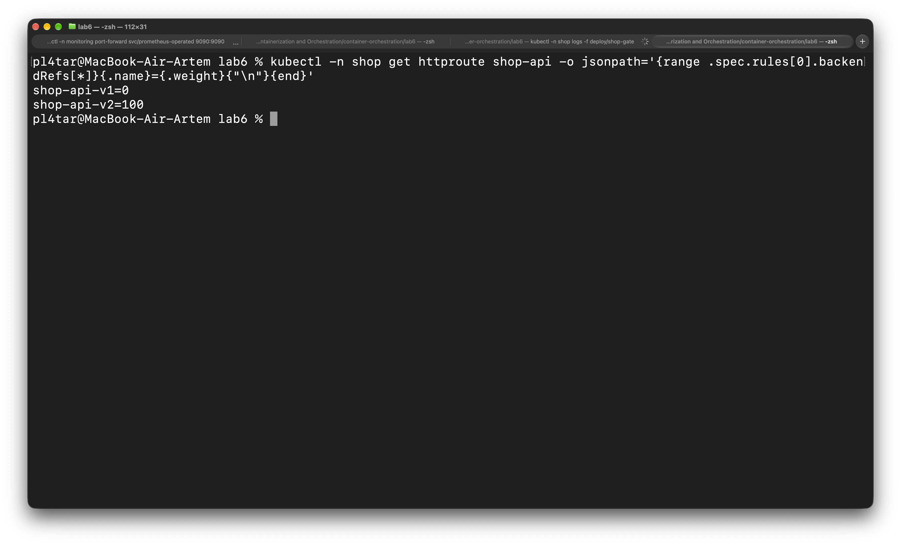

Оба сценария на одном графике: заданный вес, фактическая доля v2 и её ошибки.

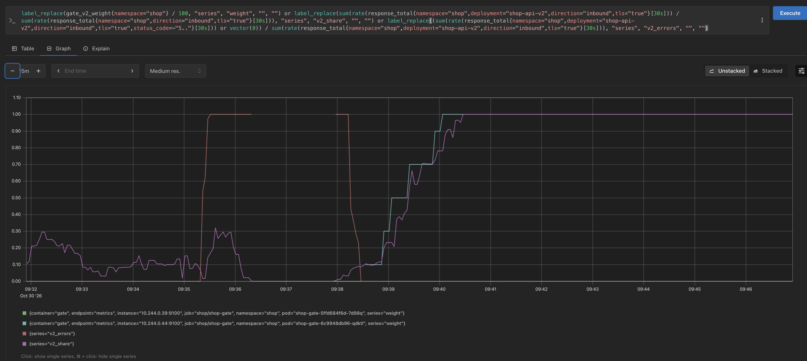

За 12 минут обоих сценариев k6 получил 13 ошибок из 21503 запросов (0,06%).

---

## Часть 8 - Цена и вердикт

Сравнивали в одинаковой конфигурации: 2 реплики `api`, 30 RPS, 3 минуты. Кроме baseline из Части 2 сделали контрольный прогон без mesh в тех же условиях, потому что стенд мог измениться.

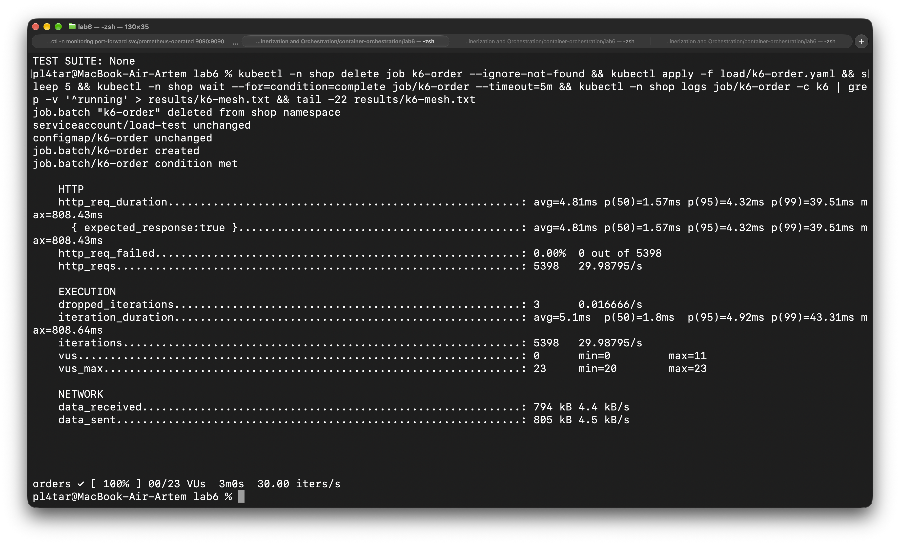

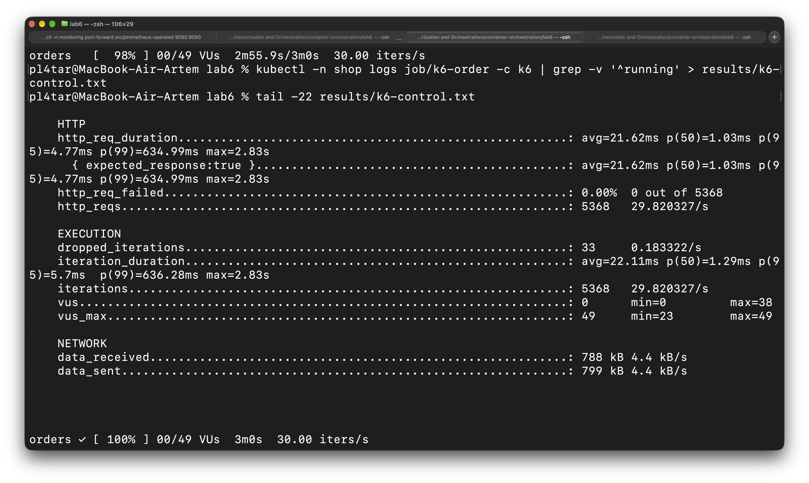

| Задержка | Baseline | Контроль без mesh | С mesh |
|---|---|---|---|
| p50 | 1,12 мс | 1,03 мс | 1,57 мс |
| p95 | 4,54 мс | 4,77 мс | 4,32 мс |
| p99 | 113 мс | 635 мс | 39,5 мс |
| max | 570 мс | 2,83 с | 808 мс |
| Ошибки | 0 из 5401 | 0 из 5368 | 0 из 5398 |

Надёжно видна только цена на p50: +0,54 мс (+52% к контролю). На p95 разница в пределах шума. По p99 и max про mesh ничего не сказать: без него они вышли хуже всего, это всплески самого стенда (см. трудности).

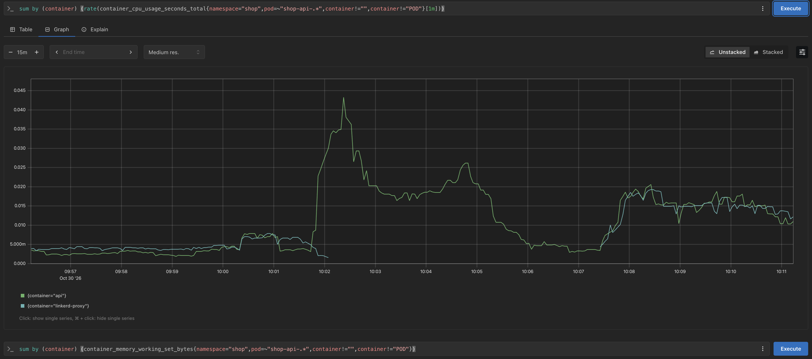

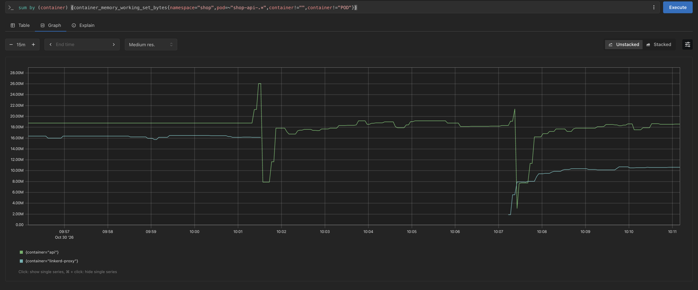

Считать только контейнер рядом с `api` нельзя: прокси есть ещё у клиента, а вокруг работает control plane.

| Цена mesh | CPU, ядра | RAM, МиБ |
|---|---|---|
| `linkerd-proxy` в подах `api` | 0,015 | 9,8 |
| `linkerd-proxy` в поде k6 | 0,013 | 5,2 |
| Control plane | 0,015 | 82,5 |
| **Итого** | **0,043** | **97,5** |
| Для сравнения: сам `api` | 0,021 | 17,2 |

Вердикт: для нашего размера mesh оправдан, но с условием. Если сравнивать с `api`, он дорогой: памяти в 5,7 раза больше, CPU примерно вдвое. В абсолютных числах это мало: около 2% памяти узла, 0,5% от 8 ядер и полмиллисекунды к медиане. За это мы без правок кода получили mTLS с identity, retries (ошибки у клиента упали с 30% до 0,9%) и автоматический откат за 45 секунд.

Держать mesh стоит, пока нужно всё это вместе. Ради одного mTLS или одних retries 82,5 МиБ постоянного control plane на один сервис были бы лишними.

Замер был при 30 RPS, по одному 3-минутному прогону, так что цифры ориентировочные. CPU прокси будет расти вместе с трафиком.

---

## Часть 9 - Мониторинг

Всё лежит в чарте. Метрики прокси собирает [PodMonitor](charts/shop/templates/podmonitor-linkerd.yaml), `/metrics` у `api` по-прежнему забирает ServiceMonitor, для веса гейта есть отдельный PodMonitor. Метки `deployment` и `version` добавляются при скрейпе, по ним считаются разрезы.

[Дашборд](charts/shop/dashboards/shop-mesh.json) показывает ошибки и p95 по версиям, разделение трафика, вес от гейта, ошибки backend против клиента и повторы на запрос. Во время `FLAKY` разрыв хорошо виден: backend 29,7%, клиент 0,78%.

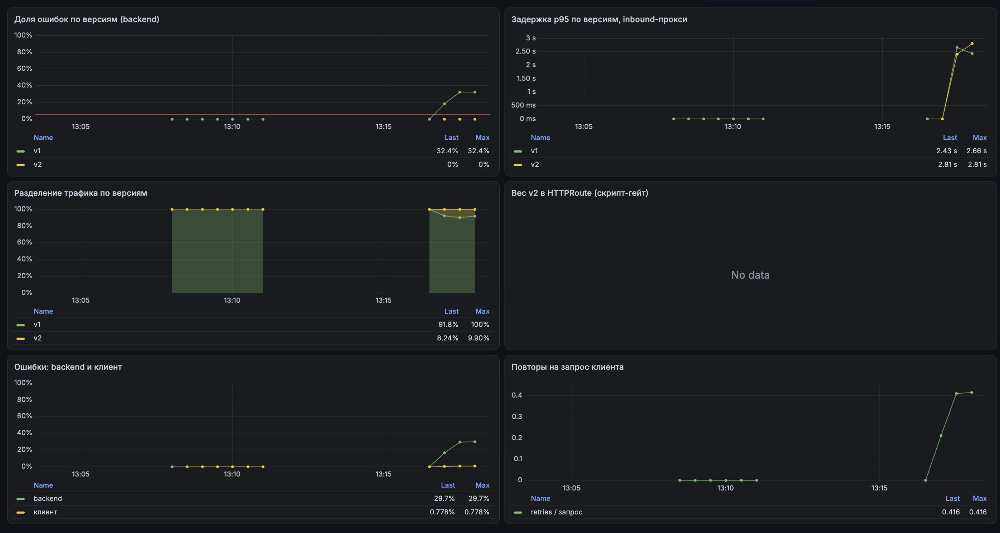

Весь эксперимент целиком: `FLAKY`, откат плохой v2, снова `FLAKY` и начало доката. Скриншот снят на весе 70%, по логам гейта v2 дошла до 100% в 10:37:58.

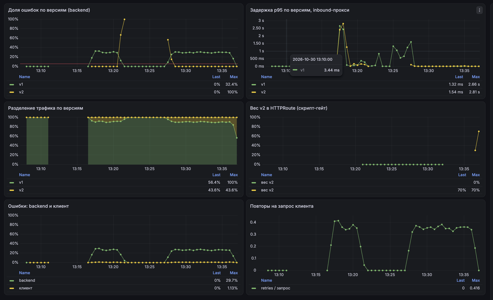

[Три алерта](charts/shop/templates/prometheusrule.yaml):

| Алерт | Условие | Почему |
|---|---|---|
| `ShopApiHighErrorRate` (critical) | Доля 5xx версии > 5%, 2 мин | Считаем на inbound-прокси, это ошибки backend. У клиента они могут быть скрыты retries, и он увидит беду последним |
| `ShopApiRetryPressure` (warning) | Повторов на запрос > 0,2, 5 мин | Показывает, сколько лишней нагрузки идёт на backend и Postgres. Срабатывает позже первого алерта, у него другая задача |
| `ShopCanaryNotCompleted` (warning) | Вес v2 < 100%, 5 мин | Гейт откатил релиз или ждёт данных, нужно решение человека. Здоровый релиз проходит за полторы-две минуты, поэтому при `for: 1m` алерт срабатывал бы на каждом успешном релизе |

Алерт только уведомляет. Откатывает гейт, и раньше: в прогоне откат был в 10:21:14, а алерт сработал в 10:26:29.

Алерта на задержку нет специально, всплески стенда давали бы ложные срабатывания. Задержка остаётся на дашборде.

Проверили все три: `FLAKY` включил первые два, откат плохой v2 включил третий.

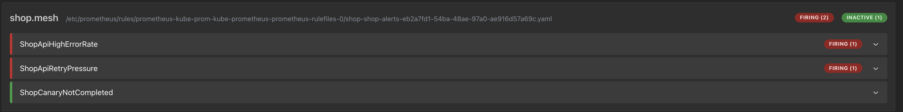

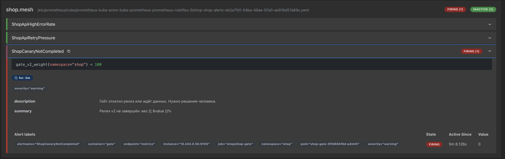

---

## Трудности

- После проверки с `--set ...all-authenticated` вернули политику обычным `helm upgrade` без флагов. Helm в таком случае берёт значения прошлого релиза, так что политика осталась, а Prometheus вне mesh перестал скрейпить `/metrics` (`up=0`). Дальше все команды шли с `--reset-values`
- Первый перехват показал не то. В 20-секундном tshark были только 105-байтные пакеты раз в 10 секунд, это keepalive между прокси. Заказы в тот момент шли на другой под, прокси балансирует неравномерно. Пересняли под нагрузкой k6
- tshark подписал пакеты `TLSv1.2`, но версию он берёт из заголовка записи, а рукопожатия в перехват не попало. Поэтому версию TLS по этому выводу не утверждаем
- Здоровая версия выглядела как «нет данных». У неё нет ни одной серии с 5xx, запрос ошибок возвращал пустоту, и гейт никогда не докатил бы релиз. Поймали на живых метриках до запуска, лечится через `or vector(0)`
- Helm и гейт правят один объект: Helm применяет через server-side apply, а веса меняет ещё и гейт. Конфликт возможен, `--dry-run=server` его не показывает, поэтому в сценариях использовали `--force-conflicts`
- Всплески задержки до нескольких секунд были и с mesh, и без него, это показал контрольный прогон. Паузы видны в метрике самого `api`, то есть внутри обработчика. Троттлинг, нагрузка на Postgres и checkpoint'ы их не объясняют, причину мы так и не нашли. Поэтому в Части 8 сравниваем по p50 и p95, а в гейте сделали две проверки подряд. В обоих докатах один всплеск задержал шаг, но релиз не откатил
- Прогон с mesh пришлось повторить. В первой попытке новый Job не запустился, и графики показали простой кластера. Заметили по пустому `k6-mesh.txt` и отсутствию нагрузки в Prometheus, потом собрали шаги в одну цепочку команд
- Следующий сценарий запустили раньше, чем истёк `for: 5m` у `ShopApiRetryPressure`, и он остался в `Pending`. Повторили `FLAKY` на полные 7 минут
- Job неизменяем, через `kubectl apply` его не поменять, поэтому перед каждым прогоном k6 его надо удалять
- Пока Postgres поднимался, `api` не открывал порт, и liveness-проба его перезапускала. На замеры это не влияет, всё заканчивалось до нагрузки
